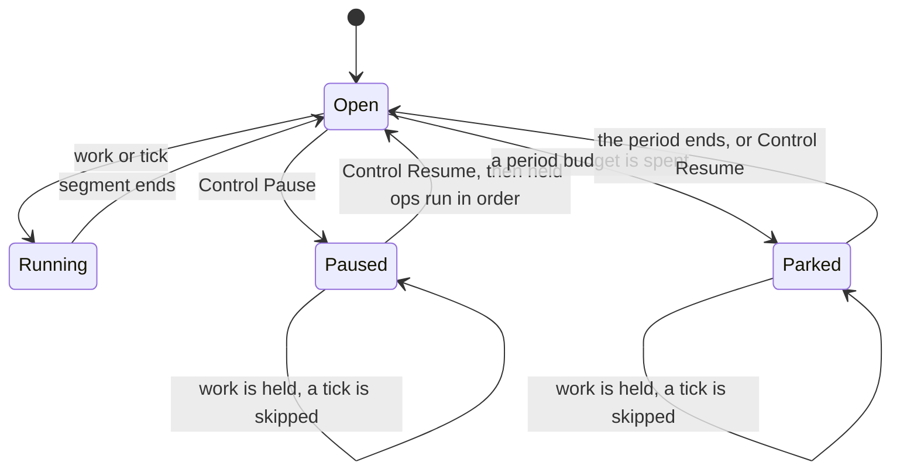

# Design: epic #2262, durable agents and agent meshes

Issue #2262 joins the agent loop (#1973), the keyed entity (#1975) and the
agent mesh into one durable `Agent`. Sub-issues #2263 to #2276 close the
gaps. This note is the spec for all of them. Each section names its issue.

**One migration (an index). One opt-in hook on `Entity`. One new
`ActivityContext` method. No new `WorkflowEvent` variant.** An
`agent_loop` history recorded before this change replays with no change.

---

## 0. Planning record

### 0.1 Facts found before the plan

- `Entity::run` (`entity.rs`) runs one handler at a time for each key. It
  records a state snapshot after each op. It carries waiting ops across a
  checkpoint. It waits with a plain `wait_for_signal`, so it has no timer.
- The entity runs on SQLite with no change. SQLite records no start source,
  so it keeps a caller input. Send `{}` as the start input.
- A workflow can signal another workflow by id, with an idempotency key, on
  both backends. The engine dedupes the key across the whole
  continue-as-new chain. Cross-shard delivery goes through the outbox.
- A workflow cannot signal-with-start. A send to a key with no running run
  fails as `target_unknown` or `not_running`.
- A durable promise is a signal named `harvest.promise:<key>`. It belongs
  to one execution, so a late settlement after a checkpoint fails.
- `ctx.race()` cancels a losing activity and records a synthetic
  `ActivityFailed`. On SQLite a running activity never sees the cancel.
- `wait_for_signal_timeout` races a signal against a durable deadline on
  both backends. A hand-written `select!` is guardrail HVG010.
- `ctx.system_now()` records the wall clock as a side effect. `ctx.now()`
  is the start time of the run.
- `ctx.upsert_search_attrs` works on both backends and appends no event.
  The management API filters with `eq`, `lt` and `gt`.
- `publish_progress` exists on `WorkflowContext` only. It is a Postgres
  `pg_notify`. SQLite drops it. An activity has heartbeats only.
- The Postgres ledger writes a row per recorded call in the transaction
  that completes the attempt. SQLite has no ledger.
- Every model turn records the whole transcript in its input. A 40-turn run
  stores 1.6 MB, and a delta stores 11% of it
  (`docs/rnd/2026-10-11-agent-history-delta-encoding.md`).
- Approval names hold the tree round. In a new tree the round starts at 0.
- PR #2305 (#2255) changes `worker.rs`, `queue.rs`, `store.rs` and
  `decision_owner.rs`. This epic does not change those files.

### 0.2 Brainstorm: how does an agent become a durable actor?

| # | Idea | Verdict |
|---|------|---------|
| B1 | A new engine actor type beside workflows. | Rejected. It duplicates replay, history, queries and the projection. |
| B2 | The agent loop inside `Entity::run`. Each op runs one segment. | **Adopted.** The entity gives one op at a time, checkpoints, snapshots and the projection. |
| B3 | Config in the start input. | Rejected. Postgres drops a caller input (#2082). A caller would choose the prompt. |
| B4 | Config as an `AgentProfile` per kind on the harness, read by one recorded activity per run. | **Adopted.** It mirrors `agent_discover_peers`. A deploy changes the next run only. |
| B5 | Wakes as an app-side scheduler that sends ops. | Rejected. One more process, and a tick can race a message. |
| B6 | Wakes as an opt-in hook on `Entity`: a deadline races the op signal. | **Adopted.** A tick is an op, so it never overlaps a message. |
| B7 | A peer send as an activity that calls signal-with-start. | Rejected. The agent crate has no Postgres client, and a SQLite activity cannot reach the runtime. |
| B8 | A peer send as `signal_external_workflow_by_id_with_idempotency`. | **Adopted.** It commits in the decision on one shard, and it uses the outbox across shards. |
| B9 | A reply as a durable promise that the caller races. | **Adopted.** A late reply fails at the sender, so no stale signal stays. |
| B10 | Memory as a second store with edit keys. | Kept for `agent_loop`. An `Agent` can keep memory in its state instead (#2273). |
| B11 | Live tokens through history. | Rejected. Each token would be an event. |
| B12 | Live tokens through `pg_notify` from the activity, tagged with the attempt. | **Adopted.** It is the path of `publish_progress`. Nothing is stored. |
| B13 | A transcript delta in the engine. | Rejected by the R&D study. |
| B14 | A transcript delta in the agent layer: a prefix digest and the new messages. | **Adopted.** It runs before the codec. |

### 0.3 Reverse brainstorm: how can this cause harm?

| # | How to make it harmful | Counter-measure |
|---|------------------------|-----------------|
| R1 | Drop an op that arrives while the agent is paused. | The inbox holds it. A Verus proof shows that each op runs once or stays held, in order. |
| R2 | Let a stale approval release a call in a later op. | The state carries the round counter, so names never repeat for one agent. |
| R3 | Reuse a tool idempotency key after a delete and a new start. | The run id holds the incarnation, the execution id of the first run. |
| R4 | Lose the taint of a tool that ran in a failed op. | A failed op restores the transcript only. It keeps the labels and the usage. |
| R5 | Let a client forge a heartbeat or a follow-up op. | Wake ops do not deserialize. Only the wake hook makes them. |
| R6 | Deliver a peer message twice after a crash. | The engine dedupes the send key. The receiver also keeps the applied set of each sender. |
| R6b | Drop a real message as a duplicate. | The receiver never drops a number for being under its high-water mark. The TLA+ model found that loss: the outbox can deliver 2 before 1. |
| R7 | Widen a mandate through a peer message. | The receiver takes `local.accept(inbound)`, which only narrows. |
| R8 | Hang on an A→B→A request. | Each request carries the waiting chain. A send to a waiting agent fails at once as a deadlock. A deadline ends any other wait. |
| R9 | Interrupt a write tool halfway. | A tool call races the interrupt only when its tool opts in. |
| R10 | Run a write tool in an unattended tick. | A tick is read-only unless its heartbeat allows actions. The tool-call activity checks again. |
| R11 | Replay an old `agent_loop` history into new commands. | Each new command shape is gated by a patch marker or used only by the new `agent` workflow. |
| R12 | Store live tokens. | The live path never writes. A DB test checks `harvest_stream_chunks` and history. |
| R13 | Grow history with the transcript each op. | The window bound trims the transcript. The delta cuts each turn. The entity checkpoints at its byte budget. |
| R14 | Overrun a token budget with concurrent children. | Siblings split the remainder. A Verus proof shows the shares sum to it. |
| R15 | Keep untrusted taint out of memory. | Memory entries carry labels. A read adds them to the run. |
| R16 | Adopt a workspace snapshot from a stale attempt. | Only a recorded activity result moves the head. A lost attempt records nothing. |

### 0.4 Six thinking hats

- **White (facts).** Section 0.1.
- **Red (feelings).** An agent that never forgets a message, wakes itself,
  and shows what it waits on, feels like the right product. A mesh that
  narrows authority by construction feels safe to demo.
- **Black (risks).** Scope: fourteen issues in one branch. Each section has
  its own red tests, so a gap is visible. SQLite drops progress and never
  cancels a running activity, so the docs state both. The core changes are
  small and opt-in, to stay clear of PR #2305.
- **Yellow (benefits).** One address for an agent. Listing is an indexed
  query. A mesh keeps mandates, flow rules and budgets across agents and
  over time, which Golem, Cloudflare and Restate do not ship as engine
  guarantees.
- **Green (alternatives).** Sections 0.2 and the rejected rows.
- **Blue (process).** Spec first: this note, a TLA+ model of a peer send and
  Verus proofs of the pure kernels. Then red tests, the code, a review from
  several angles, and an AC table with evidence.

---

## 1. The agent (#2263)

### 1.1 Identity

- `AgentId` is `<kind>/<name>`. `kind` is a valid agent name. `name` has 1
  to 200 bytes of printable ASCII with no space.
- The workflow name is `agent`. The workflow id is the agent id.
- An `AgentProfile` on the harness configures each kind. The activity
  `agent_profile` reads it once per run. Replay reads the record.

### 1.2 The inbox

An op is an `EntityMessage<AgentOp>` on `harvest.entity.op`:

| Op | Class | Sender |
|---|---|---|
| `UserMessage { text, message_id, urgency }` | work | client |
| `PeerMessage(PeerEnvelope)` | work | another agent |
| `Control(Pause \| Resume \| ResetMemory \| ClearTranscript \| SetHeartbeat)` | control | client |
| `HeartbeatTick` | tick | the wake hook only |
| `FollowupDue` | tick | the wake hook only |

`HeartbeatTick` and `FollowupDue` do not deserialize. A signal cannot
forge them.

### 1.3 The state machine

`admit(status, class)` is a pure kernel:

| Status | work | control | tick |
|---|---|---|---|
| Open | run | apply | run |
| Paused | hold | apply | skip |
| Parked | hold | apply | skip |

### 1.4 Invariants

- **I1. One op in flight.** The entity awaits each handler to its end.
- **I2. An acknowledged op is never lost.** The engine stages each signal
  before it acknowledges it. The entity carries waiting ops across a
  checkpoint. The inbox holds work while paused. Each work op runs once, or
  stays held, in arrival order. Verus proves this for the kernel.
- **I3. Replay rebuilds the transcript.** Replay adopts each recorded
  snapshot. Each model turn is a recorded activity.
- **I4. A failed op is atomic for the transcript.** It keeps the labels and
  the usage that its tools and turns spent.
- **I5. Names never repeat.** The run id is `<incarnation>:s<n>`. The state
  carries the tree round, so approval names stay unique.

### 1.5 One op

1. Decide with `admit`.
2. Build the segment task from the profile and the op.
3. Run one agent-loop segment with the full harness: tools, policy,
   approvals, budgets, memory, loop guard and delivery.
4. Fold the segment into the state: transcript, labels, usage, rounds, a
   booked follow-up and the window bound.
5. Upsert the search attributes.

A checkpoint carries the state, so the transcript and the flow labels
survive continue-as-new.

### 1.6 Send an op

- SQLite: `sqlite::send(rt, &id, op, key)` uses `signal_with_start` with
  `{}` as the input.
- Postgres: the typed stub or `POST /workflows/agent/signal-with-start`.
  `agent::signal_payload(op)` builds the payload.

---

## 2. Transcript delta (#2264)

- `ModelTurnRequest` gains `prefix: Option<PrefixRef { digest, len }>`.
  With a prefix, `messages` holds only the messages after it.
- The digest is a chain: `sha256(previous digest, added messages)`.
- The model-turn activity resolves the prefix through a `TranscriptStore` on
  the harness. Each activity stores its own link `{prev, added}` under its
  digest before the call. An in-process cache serves a warm worker.
- The window that reaches the model is byte-identical to the full form. The
  response cache key and provider prompt caching see no change.
- `agent_loop` uses the delta only when the task sets
  `transcript_delta` and the run records the patch marker. An old history
  has neither, so it replays as it ran.

---

## 3. Mid-turn messages (#2265)

| Urgency | Client sends | Effect |
|---|---|---|
| `queue` | the op | It runs after the current op. |
| `steer` | a steer signal, then the op | A running segment adds it before its next turn. The op is then a no-op. Otherwise the op runs it. |
| `interrupt` | an interrupt signal, then the op | The running model call or opted-in tool call ends. The op runs next. |

Policy for each in-flight activity kind:

| In flight | On interrupt |
|---|---|
| Model turn | Cancelled. The turn is recorded as interrupted. |
| Tool call, tool opts in (`Tool::interruptible`) | Cancelled. The result says so. |
| Tool call, no opt-in | Runs to its end. The segment then stops. |
| Approval wait | Ends as a rejection. |
| Peer reply wait | Ends. The result says so. |

The interrupt is recorded by the race, so replay takes the same branch.
Every steer and every op is a staged signal before it is acknowledged.

---

## 4. Wakes (#2266)

- `Entity::wakes(f)` is an opt-in hook. When it returns a deadline and an
  op, the loop races the op signal against the deadline. A due wake runs
  before a waiting op. An entity with no hook records the same commands as
  before.
- The heartbeat is profile config. `Control::SetHeartbeat` overrides it for
  one agent. After a tick, the next one is one interval after the tick.
- A follow-up is a booked deadline in the state. The chain count is state,
  so the cap holds across a checkpoint.
- A paused or parked agent skips a heartbeat. A booked follow-up waits.
- `agent_next_wake_at` and `agent_wake_reason` are search attributes.

---

## 5. Lifecycle (#2267)

- Idle: an agent that waits holds no worker memory. A fresh runtime serves
  its next op and its next wake.
- Search attributes: `agent_kind`, `agent_status`, `agent_last_active_at`,
  `agent_next_wake_at`, `agent_wake_reason`, `agent_tenant`, `agent_mesh`
  and `agent_tokens_used`. Times are epoch milliseconds.
- A partial expression index serves a list by status and next wake.
- Erasure deletes the agent, erases each run, and removes its stream chunks,
  its ledger rows and its memory scope. It reports each count.
- `harvest agents list | describe | pause | resume | erase` in the CLI.

---

## 6. Live tokens (#2268)

- `ActivityContext::publish_progress(chunk)` sends a best-effort chunk with
  the attempt number. Postgres uses the `publish_progress` channel. SQLite
  and the test engine drop it, or pass it to an installed sink.
- `AgentModel::chat_streaming` has a default that calls `chat`. A
  streaming adapter sends each token delta.
- When a turn completes, the `agent` workflow publishes the final text with
  `publish_durable_progress`. A client that reconnects reads it once.

---

## 7. Durable peers (#2269)

- `Peer::agent(name, id)` names a durable peer. A `delegate` call to it
  sends a `PeerMessage` to that agent and waits for the reply.
- The send key is `<from>:<seq>`. `from` is `<agent id>@<incarnation>` for
  a durable sender, and the run id of an `agent_loop` sender. A new life of
  the sender counts from 1 again, so `from` must hold the incarnation.
- The sender keeps one sequence for each receiver, in its durable state. One
  sequence for all peers leaves gaps at each receiver, and its floor stops.
- The receiver keeps the applied numbers of each sender: a floor, and a set
  above it. A number is a duplicate only when it is in that set. A
  high-water mark would drop message 1 after message 2, and the outbox can
  deliver them in that order. `AgentMeshLastSeq.cfg` shows the loss.
- The envelope carries `Mandate::outbound` and the tree labels. The receiver
  runs under `local.accept(inbound)` and starts with the labels.
- The reply is a durable promise. The caller races it against the deadline
  and the interrupt signal.
- The envelope carries the waiting chain. A send to an agent in the chain
  fails at once with `Refusal::Deadlock`.
- A send needs a running target. Start each agent of a mesh first.
- `formal/tla/AgentMesh.tla` models a send across a crash and an owner
  change. Its invariants are exactly-once delivery and mandate narrowing.

---

## 8. Concurrent children (#2270)

- The `delegate` calls of one turn run at the same time, up to
  `Mandate::max_concurrent`. The tree state is shared, so the round
  counter and the labels stay consistent.
- Siblings split the token remainder. `sibling_cap` gives each its share,
  and Verus proves the shares sum to the remainder.
- `agent_loop` gates the fan-out with a patch marker.

---

## 9. A model per agent (#2271)

- `AgentHarness::model_named(name, model)` registers a model.
- `AgentProfile::model`, `Peer::model` and `HeartbeatTask::model` name one.
- `ModelTurnRequest::model` records the name. Replay and the cache key use
  it. The ledger records the model id.
- `Mandate::models` limits the models of a subtree.

---

## 10. Mesh-wide controls (#2272)

- `AgentProfile::mesh` names the mesh. Each envelope carries it.
- `MeshBudget` caps tokens or cost for each mesh and period. A
  `MeshSpend` source sums the ledger. A spent budget parks the agent until
  the period ends.
- `pause_mesh` sends `Control::Pause` to every agent of a mesh and returns
  an audit record.
- Memory entries carry the labels of the run that wrote them. A read adds
  them to the run.

---

## 11. Memory as state (#2273)

- `AgentMemory::State` keeps the blocks in the agent state. The workflow
  runs the `memory` tool itself. The edit commits with the op snapshot, so
  no edit key is needed.
- The snapshot is rendered once per segment, so the prompt stays stable.
- The projection row and the snapshot events hold the memory. Erasure and
  codec rotation cover both.

---

## 12. Workspaces (#2274)

- A `WorkspaceStore` keeps content-addressed snapshots, encoded by the
  codec.
- The state holds the head reference. Only a recorded tool result moves it.
- Erasure deletes every snapshot of the agent.

---

## 13. SQLite ledger (#2275)

- `harvest_llm_ledger` in the SQLite schema, keyed as on Postgres.
- The runtime writes the rows in the transaction that completes the
  attempt. A crash before that writes nothing, so a re-run counts once.

---

## 14. The capstone (#2276)

`examples/agent-mesh`: a triage agent with a heartbeat over an inbox. It
asks durable researcher and critic peers, streams its answer, and waits for
an approval before a write tool. A simulator sweep checks four invariants:
no lost or duplicate message, no widened mandate, no budget overrun, and no
write in an unattended tick.
