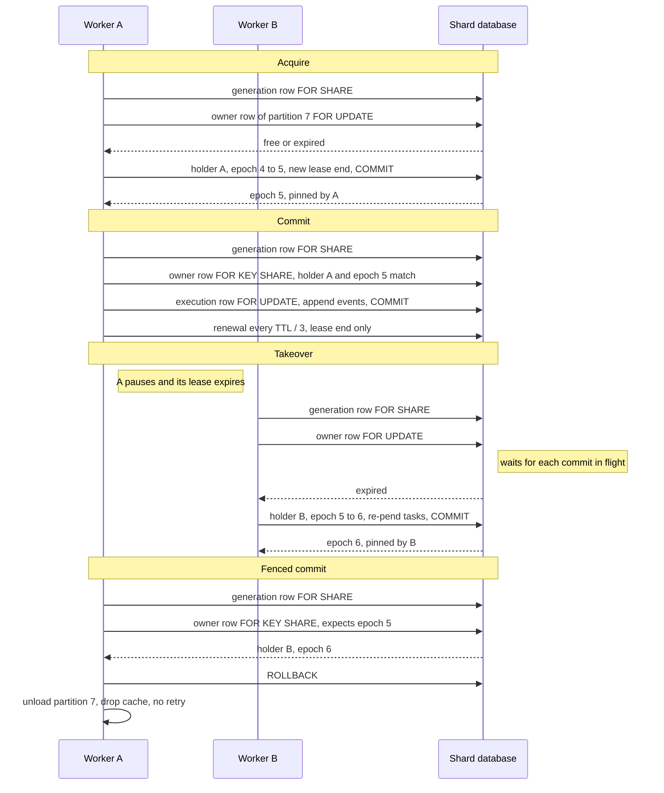

# ADR 0009: One fenced owner per decision partition

## Status

Accepted (issue #2249).

Issues #2250 to #2255 build it. Issue #2253 adds decision 12. Issue #2255
adds decision 13.
[ADR 0010](0010-fenced-owner-lease.md) holds the lease rules R1 to R7 that
the model forces. The planning record is
[`docs/design/DESIGN-2249.md`](../design/DESIGN-2249.md). The source is the stage 1 section
of `reports/Actor ownership prior art for Harvest.md`.

## Context

- Any worker can claim any workflow task with `FOR UPDATE SKIP LOCKED`.
  Assay 0014 counts 7 claims per workflow. Four of them are workflow-task
  claims ([`benchmarks.md`](../benchmarks.md)).
- Epic #2247 adds a compute owner per key. Postgres stays the only store of
  truth.
- Every surveyed system that guarantees one writer checks ownership inside
  the storage commit. A lease alone does not stop a paused owner.
- Some choices are hard to change later. The partition count is permanent
  once rows hash to it. The lock order must not add a deadlock. The fence
  rules decide what a stale owner can do.
- "Shard" already means a logical shard, usually one Postgres database. The
  new unit needs its own name.

## Decision

### 1. Name: decision partition

A **decision partition** is a fixed hash bucket of executions inside one
shard database. One owner at a time decides for its executions. "Shard"
keeps its meaning. Docs, metrics and logs say "decision partition", or
"partition" when the context is clear. The glossary is in
[`sharding.md`](../sharding.md#glossary).

### 2. Count: 512 per physical database

- Each physical database has 512 decision partitions, numbered 0 to 511.
  Colocated logical shards share one database and its 512 partitions.
- The enable step (decision 11) writes the count into the database once. A
  process that reads another count refuses owner mode on that database.
- The count of a database never changes. Restate also fixes its count at
  provisioning. A new count needs a new physical database.
- Akka sizes at ten times the largest node count. Temporal runs about 500
  shards per history process. Golem uses 1024 for a whole cluster.
- Harvest counts per physical database, so N databases give 512 × N
  partitions. At the Akka ratio, 512 serves about 50 workers on one
  database.
- A worker renews all its partitions in one statement. The count does not
  set the number of round trips.

### 3. Hash input: `workflow_id` alone

- The partition is `seahash("harvest.decision_partition" + workflow_id)`
  modulo the count. `seahash` is stable across processes, as in
  `ShardRouter`. The prefix keeps the result independent of shard routing.
- The start path computes the partition and stores it on the execution
  row. A workflow retry and a fork get a new `workflow_id`, so they compute
  it on the start path too.
- Continue-as-new and reset keep `workflow_id`, so they copy the stored
  value. A shard rebalance copies it when both databases have the same
  count, and computes it again when they do not.
- `(workflow_name, workflow_id)` is rejected. Cross-type continue-as-new
  (`continue_as_new_as_type`) keeps `workflow_id`, shard and queue. The
  predecessor seal and the successor insert are one transaction.
- With the type in the hash, the successor goes to another partition. The
  old owner then writes into a partition that it does not own. The new
  owner starts cold.
- With `workflow_id` alone, one entity chain keeps one owner across its
  phases. A transition that changes the shard is already rejected.
- Two types that share a `workflow_id` share a partition. This changes
  placement only, not correctness.
- A child has its own `workflow_id`, so it has its own partition.

### 4. Lease placement: the history's own database

- Each physical database holds one owner row per partition:
  `harvest_decision_owner(partition, holder, epoch, lease_until)` (issue
  #2251). The migration seeds rows 0 to 511 at epoch 0. A trigger refuses
  an epoch that falls or grows by more than 1, a new holder at the old
  epoch, and a changed partition.
- A worker keys each tenure by the shard of the claim's pool and the
  partition (`OwnerKey`), because it can serve several databases. The pool
  names the database of the owner row. The bits of an execution id do not.
- The row is in the database that holds the history it fences. It fails
  over with the data, and its check is atomic with the append.
- The DR fence rejects a TTL lease because the lease fails over with the
  database. For ownership, that property is the requirement.
- The DR bump (`bump_generation`) also expires every owner lease, in the
  same transaction as the bump. Workers in the promoted region then
  acquire at once. The generation fence still stops the old region.

### 5. Epoch: each acquisition increments it

- Each acquisition sets the epoch to epoch + 1. This includes a holder that
  takes back its own lapsed lease. A renewal never changes the epoch, and
  a release never changes it.
- The scanner lease counts holder changes only. The owner lease must not
  copy that rule, because a holder can unload its state after its lease
  lapses.
- The holder is a token per process: the worker id and a start nonce. A
  replacement worker with the same id is a new holder.
- A holder pins the epoch that its own acquisition returns. It never adopts
  an epoch that it reads later.
- Renewal, release and revoke match both holder and epoch. A renewal also
  requires a live lease. A lapsed holder acquires again, at a new epoch.
- A forced bump drains in-flight commits first, as Temporal's
  `renewRangeLocked` does. In Postgres the drain is a lock wait.
- The acquisition takes the row `FOR UPDATE`. That waits for each commit
  that holds the row `FOR KEY SHARE`. A commit after the acquisition sees
  the new epoch.
- A `FOR KEY SHARE` request does not queue behind a waiting `FOR UPDATE`.
  A commit that starts while an acquisition waits passes at the old epoch.
  It extends the drain and stays safe.
- A steady stream of such commits can delay an acquisition without bound.
  So the holder stops starting commits in a partition at its local
  deadline (decision 8) and before a release.
- A holder that takes back its own lapsed partition first stops its
  decisions there and drops their cache entries.
- The commit checks holder and epoch, not the lease end. Safety needs the
  epoch only. An expiry check fails a healthy commit when no other worker
  acquires.
- A scan takes its picks in one transaction, `acquire_many` (issue #2296).
  The statement count of a scan does not grow with its picks.
- The batch locks its takeable rows `FOR UPDATE SKIP LOCKED`, in ascending
  partition order. It skips each row that another transaction locks.
- The batch increments the epoch only on the rows that it locked. So no
  commit is in flight on them, and the drain holds. A later scan takes a skipped row.
- So a batch never waits for an owner row. One busy row does not delay the
  rest of the batch.

`decision_owner_lock_modes_db_tests.rs` proves these lock modes on
Postgres 16. In each row, the first transaction holds its lock while the
second statement runs.

| First transaction | Second statement | Second waits | Proof |
|---|---|---|---|
| Commit, `FOR KEY SHARE` | Renewal, an `UPDATE` of the lease end only | No | `a_renewal_does_not_wait_for_an_in_flight_commit` |
| Renewal | Commit, `FOR KEY SHARE` | No | `a_commit_does_not_wait_for_an_in_flight_renewal` |
| Commit, `FOR KEY SHARE` | Acquisition, `FOR UPDATE` | Yes: the drain | `an_acquisition_waits_for_an_in_flight_commit` |
| Commit, then a committed renewal | Acquisition, `FOR UPDATE` | Yes | `an_acquisition_still_waits_after_a_renewal` |
| Commit, and an acquisition that waits | Commit, `FOR KEY SHARE` | No. It passes at the old epoch. | `a_commit_does_not_queue_behind_a_waiting_acquisition` |
| Commit, `FOR KEY SHARE` | An epoch `UPDATE` with no `FOR UPDATE` | No. Owner code must not use it. | `a_plain_epoch_update_does_not_wait_for_a_commit` |
| Commit, `FOR KEY SHARE` | The scanner lease upsert | No. Owner code does not copy it. | `a_scanner_style_upsert_does_not_wait_for_a_commit` |
| Commit, `FOR SHARE` | Renewal | Yes. So the commit does not use `FOR SHARE`. | `a_for_share_commit_blocks_a_renewal` |
| A frozen commit with a local idle timeout | Acquisition, `FOR UPDATE` | No, after the timeout | `a_local_idle_timeout_frees_a_frozen_commit` |
| Commit, `FOR KEY SHARE` | Batch acquisition, `FOR UPDATE SKIP LOCKED` | No. It skips the row and keeps its epoch. | `a_skip_locked_acquisition_skips_an_in_flight_commit` |

From the scanner lease, copy the `clock_timestamp()` read after the row
lock and the `lock_timeout`. Do not copy its upsert or its holder rule.

### 6. Lock order: generation, owner, execution

A decision commit in owner mode takes its locks in this order:

1. The DR generation row `FOR SHARE`, when the DR fence is on
   (`assert_fence`).
2. The owner row of the execution's partition, `FOR KEY SHARE`.
3. The execution row `FOR UPDATE`, then each lock in the lock-order table
   of [`architecture.md`](../architecture.md#lock-order-table).

Rules:

- Each transaction that takes an owner row takes the generation row first.
  This covers acquisition, renewal, release, revoke and the DR bump.
- The owned claim is the exception (issue #2252). It reads the generation
  row without a lock, as every claim does. Its owner row lock uses
  `SKIP LOCKED`, so it never waits.
- A decision commit or an owned claim takes at most one owner row.
- A decision commit takes that row before any execution row, task row or
  advisory lock.
- An owned claim takes its owner row in the claim guard, after its task
  row. It uses `SKIP LOCKED`, so it never waits for the owner row. A
  skipped row is a takeover, and the claim takes no task. So the late
  order adds no wait edge (issue #2252).
- Renewal, release and revoke take the generation row and owner rows
  only. An acquisition takes them, then locks the workflow task rows that
  it re-pends (decision 7).
- A statement on many owner rows locks them in ascending partition order.
  A plain `UPDATE ... WHERE partition = ANY(...)` does not do that. It
  locks rows in scan order.
- Use a locking `SELECT ... ORDER BY partition` first, then the `UPDATE`.
  `a_multi_row_renewal_locks_rows_in_ascending_order` pins this.
- A foreign writer takes no owner row. The execution row lock serializes
  it, as today.
- Offloaded payloads upload before the fenced transaction opens, as each
  `assert_fence` caller does today.

This adds no deadlock:

- An acquisition holds the generation row and owner rows, then locks task
  rows. No path holds a task row and then waits for an owner row. Claims
  and commits take the owner row first, and foreign writers take none.
- So an acquisition never waits on a transaction that waits on it. A task
  row lock that it cannot get in its `lock_timeout` rolls the acquisition
  back. The next scan tries again.
- A commit does not queue behind a waiting acquisition (decision 5).
- While a commit waits for an owner row, it holds only the generation row,
  in shared mode. Every owner-row transaction takes that row in shared
  mode too.

The existing order does not change. Rows 4 and 5 of the lock-order table
take an advisory lock before the execution row. Row 10 takes a quota
advisory lock after it. Rows 8 and 9 order advisory locks among
themselves.

Row 16 is the known cycle from [`sharding.md`](../sharding.md): a
`cancel_running` admission against `ctx.mutex`, which aborts with `40P01`.
Both of its locks are advisory locks. The admission and the terminal
chokepoint take the owner row, if any, before both. So the owner row adds
no edge to that cycle.

Owner mode changes one path. Today the workflow-task persist locks the
execution row first (`check_paused_and_park`). It checks the generation row
at its first append. Owner mode moves both fence reads to the start of the
transaction (`assert_decision_fence`). Row 19 of the lock-order table holds
the owner row. `a_decision_takes_the_owner_row_before_the_execution_row`
pins it.

Every transaction of a decision starts with `assert_decision_fence`. That
covers the wake ingest and the inline local activity and signal writes. It
also covers the suspension and terminal persists and the projection writes.
The decision pins its
tenure in a task-local, so a foreign writer in another task takes no owner
row. A local activity handler is user code. It runs in a nested scope that
pins nothing, so its own writes are foreign writes. The body-timeout
quarantine pins the tenure of the run and fences too.

Each event insert calls `assert_fence` too, which fences the pinned tenure
again. That covers a write that a future path adds without a start fence.
A transaction that already holds the row passes at once.

The fence is the migration's function `harvest_decision_owner_fence`. Its
lock wait is at most 250 ms, set on the function. A failed acquisition
recheck holds the row `FOR UPDATE` for a moment, even on a live lease, so a
healthy owner must wait briefly. A longer hold is a takeover, so the fence
fails closed. The wait is short and ends in a refusal, so a late fence
after other row locks cannot deadlock. A wait for the table lock counts too.
So a migration that queues an `ACCESS EXCLUSIVE` lock on
`harvest_decision_owner` fences every commit until its `lock_timeout` ends.
Keep that timeout short, as `online-migrations.md` requires.

### 7. Fenced commit: unload, never retry

When the holder or the epoch differs:

- The decision transaction rolls back as a whole. It appends no event. No
  `WorkflowEvent` variant records the fence, as with the DR fence.
- The worker marks the partition lost and stops its claims there.
- It drops the resident futures and `WorkflowCache` entries of each
  execution in the partition.
- It never retries at the stale epoch. It can acquire the partition again
  later, at a new epoch.
- It counts the fence on `harvest.decision_owner.fenced{shard}`.
- The execution row lock and `UNIQUE(workflow_exec_id, event_id)` stay as
  the backstop.

No task stays `RUNNING` with no worker to finish it:

- The owned claim takes the owner row `FOR KEY SHARE` and matches the
  holder. A stale owner cannot claim after a takeover. A holder that takes
  back its own row needs no epoch check: its later decisions fence.
- The acquisition re-pends each `RUNNING` workflow task of the partition
  that a dead worker holds. Issue #2252 does this in one statement per
  scan, after the acquisitions commit. A claim of the old owner that
  commits later fails the guard.
- A live worker keeps its claim. A live old owner fails its fence and
  re-pends its own claim. A live legacy worker finishes its decision. So
  no decision runs twice at once.
- A fenced worker re-pends its own claim under its claim token, as
  `requeue_claimed_workflow_task_*` does today.
- Issue #2252 builds the first two steps. Issue #2251 builds the third
  (`requeue_claimed_workflow_task_after_fence`).
- With owner mode on and no tenure, a decision fails closed with
  `OwnershipLost` and writes nothing.

### 8. Lease TTL: 10 s, renewed every TTL / 3

- The default TTL is 10 s, the same as `DEFAULT_SCANNER_LEASE_TTL`.
- The holder renews every TTL / 3. One lease then covers `MIN_LEASE_TICKS`
  (3) renewals, as for the scanner lease.
- The TTL range is 3 s to 300 s. The top is `MAX_SCANNER_LEASE_TTL`. The
  3 s floor is new: the scanner lease has none.
- A standby scans for free and expired partitions every second.
- It also scans just after the next foreign lease end, when that end
  comes first (issue #2254). So a takeover follows a lease end by
  milliseconds.
- After a crash, a partition gets a new owner a few milliseconds after
  its lease ends. That is about one TTL, 10 s by default. A graceful stop
  hands over in about 1 s (decision 9).
- A peer still counts as live for 3 s after its last scan. Near the 3 s
  floor, that window can delay a takeover by up to 1 s more.
- Issue #2254 measured the next decision 0.2 s to 0.3 s after the lease
  end. See [`performance-owner-failover.md`](../performance-owner-failover.md).
- A frozen owner can hold an open commit transaction. Its `FOR KEY SHARE`
  then stops each acquisition of that row.
- So the owner-mode decision transaction sets
  `idle_in_transaction_session_timeout` to at most the TTL, with
  `SET LOCAL`. The database then ends a frozen transaction.
- The holder computes a local deadline on a monotonic clock. The deadline
  is the send time of the last successful acquisition or renewal, + TTL −
  one renewal interval.
- At that deadline the holder stops new claims and new commits in the
  partition.
- Safety does not depend on clocks, because the commit checks the epoch.
- Issue #2254 measured the crash bound at the default TTL only. So Harvest
  still rejects a TTL below 3 s. A missed renewal under load causes a
  takeover, cold decisions and fenced commits.

### 9. Drain: release all at once

On a graceful stop, a worker:

1. Stops new claims and new commits in every partition.
2. Waits for its in-flight decisions, up to the drain bound.
3. Releases every partition in one statement. The statement sets the lease
   end to `clock_timestamp()` and keeps the holder and the epoch.

Standbys acquire on their next scan. A decision still in flight at the
bound keeps its row lock. The batch skips that row, and a later scan
takes it (issue #2296). There is no
named successor and no serial handover. Golem's serial drain gave each
shard 5 s and failed (golemcloud/golem#3766).

A worker targets ⌈512 / live owners on the database⌉ partitions. It
releases a partition when it holds more than that target + 1. It drains
the partition first, as in steps 1 and 2.

Issue #2252 fixes the balance policy (`decision_owner::plan_balance`):

- Live owners are the owner loops that wrote their candidate row in the
  last 3 s (`harvest_decision_owner_candidates`). A loop writes it on each
  scan. A crashed worker drops out within 3 s.
- A worker that cannot run a workflow task is no candidate. This covers
  a worker with no workflow slot or type, and a split colocated group.
  It still claims in the owned form, so the guard never blocks it.
- A worker below the target acquires free partitions up to the target.
- The worker acquires at most 32 partitions per scan, in one transaction
  (issue #2296). It adopts them, then scans again at once while free
  partitions remain (issue #2254). So its first decisions do not wait for
  its last acquisition.
- A worker above target + 1 stops claiming the extra partitions at once.
  It releases them one full scan interval later, so their decisions in
  flight can commit. That is the drain.
- Any worker acquires an orphan: a free partition whose lease ended more
  than one TTL ago.
- Issue #2254 raised that wait from one renewal interval. A joiner under
  load took more than 3.3 s for its share. Owners at their target then
  took those partitions as orphans, and the fleet churned for 14 s to 16 s.

### 10. Tenant cells: partitions follow shard assignments

- Partitions are inside one physical database. A worker acquires
  partitions only on the shards of its effective assignments
  (`resolve_shard_assignments`).
- On a database with colocated shards, each worker in owner mode covers
  all of those shards or none. A split strands executions, because 512
  owner rows serve every shard on the database.
- A worker whose assignments split a colocated group refuses owner mode at
  start. Today one claim scan already serves every shard on such a
  database.
- The cell recipe gives each pool explicit assignments
  (`with_shard_assignments`). When the cell shard has its own database,
  only the cell pool can own its partitions.
- A cell that shares a database with other shards shares its partitions
  too. A cell needs its own database for owner isolation.
- Owner mode is per physical database. A cell can turn it on alone.
- No new configuration is needed.

### 11. Rollout: a per-shard switch that fences the legacy claim

Owner mode is a per-physical-database switch. The switch is a row in that
database. The enable step:

1. Refuses while a live worker on the database cannot run owner mode, or
   covers only part of a colocated group (decision 10). Issue #2252 picks
   the signal, because `harvest_workers` has no capability column today.
2. Writes the partition of each execution and the count. The migration of
   issue #2251 already seeds the owner rows.
3. Installs a database guard on the claim of a workflow task. The guard
   refuses a claim that carries no owner epoch.
4. Re-pends each workflow task that is `RUNNING` under a legacy claim,
   under its claim token, or waits until none is left.
5. Sets the switch row.

Steps 3 to 5 run in one transaction. Step 1 is a courtesy check, because a
worker can start after it. The guard in step 3 is the structural part.

A binary from before owner mode sends no epoch, so it claims no workflow
task after step 3. New binaries read the switch row in the claim
statement, as the DR claim gate does. With the switch on, the legacy
workflow-task claim selects nothing. With it off, the owned claim selects
nothing.

Issue #2252 builds the step as `decision_owner::enable_owner_mode`:

- **Capability signal.** Each registration and heartbeat writes the label
  `decision_owner_version` into `harvest_workers.labels`. Step 1 refuses
  while a live worker lacks it.
- **Mixed fleet.** Step 1 also refuses while live workers poll different
  queues or run different builds. It refuses while live owners register
  different workflow or activity types, from the label
  `decision_owner_handlers`. A decision can run any activity inline. An
  owner claims every workflow task of its partitions, so it must be able to
  run each one.
- **Partition.** The column `harvest_task_queue.decision_partition` holds
  the partition of a workflow task. Each writer stamps it at insert. Step
  2 stamps the live rows. An owned claim may take an unstamped row. The
  worker then stamps it and re-pends it to its owner.
- **Claim signal.** The owned claim sets the transaction setting
  `harvest.owner_claim` to its holder token. A binary from before owner
  mode never sets it. The guard reads this token in place of an epoch.
  It checks neither the epoch nor the lease end. A released lease keeps
  its holder, so the releaser's local deadline stops its claims.
- **Guard.** The trigger `harvest_task_queue_owner_claim_guard_trg` runs
  for the claim of a workflow task only. With no token, it skips the row,
  so a legacy claim selects nothing. For a stamped row, it takes the owner
  row `FOR KEY SHARE SKIP LOCKED` and matches the holder.
- **Order.** Steps 3 to 5 run in one transaction, which first locks the
  switch row. A failure leaves owner mode off and the guard off. There is
  no window in which no claim can take a workflow task.
- **Step 4.** The transaction re-pends only the legacy claims of workers
  that are not live. A live worker finishes its own decision and parks
  the task, and then an owner claims it. So no legacy decision runs next
  to an owner on one execution.
- **Live owners.** Step 1 also refuses while no owner loop is live.
- **Locks.** `CREATE TRIGGER` and `ENABLE TRIGGER` take `SHARE ROW
  EXCLUSIVE` on `harvest_task_queue`, which does not block a reader. A
  `lock_timeout` bounds each wait. These statements need ownership of the
  table.

After step 3, no task can be claimed in two ways. An old binary can still
finish a decision that it claimed before step 3. Step 4 and the execution
row lock bound that case. Activities stay on the shared claim in both
modes.

The disable step clears the switch row first, then removes the guard.
`decision_owner::disable_owner_mode` does both in one transaction. It
turns the trigger off with `DISABLE TRIGGER`, not `DROP TRIGGER`, so it
takes no `ACCESS EXCLUSIVE` lock.

### 12. Foreign writers: wake the owner, evict on a state change

Issue #2253 builds this decision.

- A foreign writer takes no owner row (decision 6). The execution row lock
  serializes it with the decision, as before.
- After its commit, the write wakes the owner of the run's partition. The
  wake is a `NOTIFY` on the channel `harvest_owner_p{n}` of that database.
- Each owner listens on the channels of the partitions that it holds. A
  worker that holds no tenure on a database opens no connection for it.
- Three paths stage the wake. `wake_workflow_task` and `enqueue` stage a
  plain wake when a workflow task of the run becomes claimable.
- The event append functions of `store.rs` stage an evict wake for a state
  change: a terminal, a pause, a resume or a redrive.
- `notify_owner` stages a wake for a change that appends no event: a
  rebalance, or a re-pend after a dead or stuck worker.
- The post-commit sender of `notify.rs` reads the `workflow_id` of each
  woken run on its own connection. The write path pays nothing.
- The sender skips each evict wake to the partition that the writer's
  decision pinned. The writer owns that partition, and it decides for its
  entries.
- A plain wake to that partition stays (issue #2255). The owner decider
  then learns of a row that its decision woke again, or of a successor in
  the same partition.
- The skip compares the partition number only. A wake to the same number
  on another database is then lost. That costs latency only.
- An evict wake drops the cache entry and its parked future. Each wake
  names its execution to the owner decider (decision 13). With owner mode
  off, a wake only ends the idle wait of the claim loop.
- A foreign append does not evict. The next decision loads the delta, so a
  child terminal written into its parent reaches the parent's owner.
- A `NOTIFY` can be lost. An evict wake can also come while a decision
  holds the entry, and that decision then puts the entry back.
- So in owner mode, a cache hit whose delta holds a state change replays
  cold. A hit whose entry has another owner key replays cold too.
- Until issue #2252 adds the switch row, owner mode turns owner wakes on
  for the process. A writer-only process calls `enable_owner_wakes`.
- That process also needs a post-commit sender (`register_pool`). Without
  one, the fallback drops each owner note.

The writer classes, from the inventory of issue #2253:

| Class | Writer | Wake | Evicts |
|---|---|---|---|
| Activity result | `worker.rs`: `finalize_activity_completion_write`, `finalize_activity_failure_write`, `record_schedule_to_close_activity_timeout`. `context.rs`: `run_transactional` | `wake_workflow_task` | No |
| Activity start | `worker.rs`: `append_activity_started_if_pending` | None. Nothing becomes claimable. | No |
| Child terminal into parent | `worker.rs`: `wake_parent_for_child_completion_with_codecs`, `wake_parent_for_child_failure`, `materialize_due_child_timeout_deadlines`. `execution.rs`: `notify_awaited_parent_of_child_terminal` | `wake_workflow_task` | No |
| Activity and outbox timeouts | `timeout.rs`: `enforce_activity_timeout`, `force_fail_activity`, `enforce_external_task_timeouts`, `wake_parent_for_child_timeout`, `enforce_external_signals_outbox`, `enforce_external_cancels_outbox`, `enforce_external_awaits_outbox` | `wake_workflow_task` | No |
| Run timeouts | `timeout.rs`: `commit_workflow_execution_timeout`, `enforce_workflow_timeout`, `enforce_workflow_history_ceiling_with_codecs` | Store append of a terminal | Yes |
| Cancel and terminate | `execution.rs`: `cancel_workflow_execution_collect_mode`, `inline_cancel`, `terminate_workflow_execution_collect` | Store append of a terminal | Yes |
| Deferred cancel | `execution.rs`: `defer_cancel_for_open_block` | None. The open block reads it. | No |
| Pause and resume | `execution.rs`: `pause_workflow_execution`, `resume_workflow_execution` | Store append. A resume also calls `wake_workflow_task`. | Yes |
| Reactivate | `execution.rs`: `reactivate_failed_execution_at`. `dlq.rs`: `redrive_dead_letter_at` | Store append, then `enqueue` | Yes |
| Parent close cascade | `execution.rs`: `apply_parent_close_cascade`, `cascade_cancel_detached_child`, `cascade_terminate_detached_child` | Store append of a terminal | Yes |
| Cross-shard relay | `cross_shard_child.rs`: `deliver_terminal`, `apply_cascade_bookkeeping`, `start_child_on_target` | `wake_workflow_task`, store append, `enqueue` | Cascade only |
| External tasks | `external_task.rs`: `complete_externally_with_codecs`, `fail_externally` | `wake_workflow_task` | No |
| External deadline | `external_task.rs`: `extend_deadline` | None. Nothing becomes claimable. | No |
| Sessions | `sessions.rs`: `break_session_and_fail_members` | `wake_workflow_task` | No |
| Reset | `reset.rs`: `terminate_source_execution`, `copy_carried_events`, `append_fork_marker`, `enqueue_fork_workflow_task` | Store append for the source, `enqueue` for the fork | The source |
| Fork | `fork.rs`: `fork_in_transaction`, `copy_prefix` | `enqueue` | No. A new run. |
| Poison pill | `poison_pill.rs`: `fail_owning_workflow` | Store append of a terminal, `wake_workflow_task` for the parent | Yes |
| Update admission | `store.rs`: `admit_update_event_with_codecs` | Each caller then calls `wake_workflow_task` | No |
| Signals | `signal.rs`: `send_signal_idempotent_with_codecs`. `execution.rs`: `stage_signal_with_idempotency` | `wake_workflow_task` | No |
| Mutex release | `mutex.rs`: `release_lock`, `reclaim_expired_leases_and_wake` | `wake_workflow_task` | No |
| Start and continue-as-new | `execution.rs`: `start_or_load_workflow_execution`, `replace_execution` | `enqueue` | No |
| Rebalance | `shard_rebalance.rs`: `commit_cutover`, `activate_target_inner` | `notify_owner` on each database | Yes |
| Dead or stuck worker re-pend | `poison_pill.rs`: `requeue_orphan`, `requeue_stuck_task` | `notify_owner` | No |
| Claim-held workflow re-pend | `queue.rs`: `requeue_claimed_workflow_task_with_backoff` | `notify_owner` when the row is due now (issue #2255) | No |
| Queue resume | `queue_pause.rs`: `notify_resumed_queue` | None. The queue wake reaches each claim loop. | No |
| Partition layout | `partition.rs`: `disable_partitioning`, `drain_default_bounded_inner` | None | No. Each row keeps its id and bytes. |
| Retention | `retention.rs`: `delete_candidate_execution` | None | No. It deletes terminal runs only. |

A durable timer is not a foreign write. The decision that starts it also
schedules its task with `reschedule_task`. The two sanctioned `event_data`
writers of `CLAUDE.md` keep the decoded history, so they need no wake.
Erasure acts on terminal runs only.

`owner_wake_worker_tests.rs` runs an owner and a non-owner worker for the
main writer classes. `owner_wake_db_tests.rs` checks the wake and its evict
flag on the channel for more classes. Session breaks and the cross-shard
relay use the chokepoints of an activity failure and a child terminal.

### 13. Owner decider: workflow tasks leave the claim loop

Issue #2255 builds this decision. Stage 1a still claimed each workflow task
with the shared head scan. Stage 1b moves workflow tasks off the claim loop.

- Each worker runs one owner decider per owned database, beside its claim
  loops. Where it runs, the claim loops claim activities only.
- A worker with queue weights, fairness keys or `priority_aging_secs` runs
  no decider. It keeps the owned claim of issue #2252. Its workflow tasks
  then follow the weighted queue order, the fairness lags of issue #1976 and
  the ageing boost. Ageing reorders every pending row. No bounded scan can
  sort it (issue #2308).
- A decider runs only on a database with an owner wake listener. With no
  wake, it finds each row by a scan, and a scan with a take costs more than
  one head claim. The claim loops then keep the owned claim.
- The decider takes workflow tasks in claim order (issue #2308). Priority
  comes first. The due time follows, with the 30 s new-start handicap of
  issue #1824. The decider keeps the ready set sorted by that key. A freed permit goes to the best
  ready execution, not to the oldest wake.
- The decider learns of work from two sources. An owner wake names an
  execution. A scan reads the pending workflow rows of its partitions in
  claim order, with `idx_harvest_tq_owner_order`.
- A wake carries no key. When the free permits cannot cover every hint, one
  statement reads the keys of the hinted rows. With enough free permits, the
  decider takes the hints at once and skips that statement, because order
  cannot matter. A failed lookup queues the hints unranked. The scan then
  corrects them.
- A full ready set drops its worst entry for a better one. It never drops a
  better entry for a worse one.
- The scan runs at each tenure change, when a permit frees after a full
  scan, and at the next due time. With no live wake listener, the gap is
  at most one poll interval. While a listener receives the owner wakes,
  the gap is at most 1 s or one poll interval, whichever is longer. A
  listener that listens again triggers a scan at once.
- So a lost wake, a due timer and the backlog of a new partition all reach
  the decider.
- A take is the owned by-execution claim. Every claim gate, the claim guard
  and the post-claim rechecks apply. It reads no queue head.
- Each take runs in its own future, bounded by the workflow permits. The
  task row serializes the decisions of one execution, so the owner
  serializes per execution, not per partition.
- A take that finds nothing backs its execution off. The backoff starts at
  one poll interval and doubles with each miss, up to 30 s. A wake ends it.
  So a refused row cannot hold the head of each scan.
- A scan reads two heads of each owned partition, new starts and
  continuations, in `idx_harvest_tq_owner_order`. It reads at most the scan
  limit from each head, never the rows of another owner and never a whole
  backlog. The merge of the heads is exact for its first rows, as the claim's
  seek window is. `idx_harvest_tq_owner_scan` gives the next due time with
  one probe per partition. Takes and scans run beside the loop, so a scan
  never stalls a take.
- The decider keeps execution ids only. A hint never acknowledges anything.
  A signal is a `harvest_signals` row before its acknowledgement
  (restate#4566).
- A claim-held re-pend that is due now wakes the owner of its partition.
  That covers a fenced owner, an unowned row and a deadlock retry. The new
  owner then learns of the row at once.
- With a DR pin, the start fence takes the generation row and the owner row
  in one statement, the migration's `harvest_decision_fence`. The order of
  decision 6 holds. The generation row waits with no bound, as before. The
  owner row waits at most 250 ms.
- Inside the fenced scope, an append checks neither row again when the start
  fence took the same generation row. The scope records that row. A
  colocated shard with its own row still checks it.
- `owner_decider_tests.rs` proves the claim count and the signal case.
  [`performance-owner-decider.md`](../performance-owner-decider.md) has the
  measurements.

## Flows

## Stage 1 questions

Each stage 1 question and risk in the report has an answer or a deferral
here.

| Key | Question | Answer |
|---|---|---|
| Hash input | Does the hash input include `workflow_name`? | Answered. No. See decision 3. |
| Tenant cells | How do partitions work with tenant cells and `with_shard_assignments`? | Answered. Partitions follow the effective assignments. See decision 10. |
| Drain | Does a graceful drain hand partitions over to a named successor? | Answered. No. One statement releases all partitions. See decision 9. |
| Lease TTL | Which lease TTL? | Answered. 10 s, renewed every TTL / 3. See decision 8. |
| Foreign writers | How do writers outside the decision reach the owner? | Answered. They take no owner row. A post-commit wake on the partition channel reaches the owner. See decision 12. |
| Cache invalidation | How does a foreign write invalidate another owner's cache? | Answered. An append wakes the owner, and its next decision loads the delta. A state change evicts. See decision 12. |
| Acknowledgement | Can owner memory acknowledge work? | Answered. No. An acknowledgement follows a durable write. `CLAUDE.md` makes this an invariant. |
| Lease expiry mid-decision | What happens when the lease lapses during a long decision? | Answered. The commit checks the epoch. The transaction aborts only when another worker acquired. See decision 5. |
| Cost of two fences | What do two fence row locks per commit cost? | Answered. Issue #2248 measured two statements at +17.8%. Issue #2255 takes both rows in one statement. See decision 13. |
| Mixed fleet | How is a mixed fleet made impossible? | Answered. A per-database switch and a database guard. See decision 11. |
| Routing | How does the claim find owned work in stages 1a and 1b? | Answered. In stage 1a the claim filters workflow rows to owned partitions (#2252). In stage 1b the owner decider takes them by execution. See decision 13. |
| Group commit | Do decisions of one partition share a commit? | Deferred to #2256. |
| Serialization unit | Does the owner serialize per partition or per execution? | Answered. Per execution. A single-threaded owner caps throughput, as at Durable Objects. |
| Model nemeses | Which nemeses do the TLA+ model and the simulator cover? | Deferred to #2250. Stale commit after takeover, lease flap during an append, renewal during commits, and a signal before an epoch bump. |
| Frozen-owner test | Does Harvest port Golem's frozen-owner test? | Answered. Yes. `owner_failover_tests.rs` stops an owner with `SIGSTOP` in a decision and in an open commit. See [`performance-owner-failover.md`](../performance-owner-failover.md). |
| Pass conditions | Which measurements pass stage 1? | Deferred to #2248 for the throughput, claim, cold-decision, hit-rate and persist rows. Issue #2254 measured the kill -9 and scale-out rows, and both pass. |

## Options considered

| Option | Verdict |
|---|---|
| A count that grows with the fleet | Rejected. Each change remaps keys. |
| 1024 partitions, as at Golem | Rejected. The count here is per database. It doubles the owner rows for no gain. |
| Hash `(workflow_name, workflow_id)` | Rejected. See decision 3. |
| Lease rows in a central database | Rejected. The lease must fail over with its data. |
| The scanner lease upsert as written | Rejected. Its epoch counts holder changes, and it does not drain. |
| Commit `FOR SHARE` | Rejected. Each renewal waits for commits. |
| Check the lease end in the commit | Rejected. It fails healthy commits. |
| One heartbeat row per holder | Deferred to #2248. Measure the renewal cost first. |
| Hand partitions to a named successor | Rejected. See decision 9. |
| A per-worker owner-mode flag | Rejected. A mixed fleet becomes possible. |
| A DR generation bump to stop old binaries | Rejected. The DR fence is optional, and the bump stops every worker. |
| Owner state in a local SQLite file | Rejected. A non-goal of epic #2247. |

## Consequences

- One entity chain has one owner. Cache hits survive the 5 s sticky
  expiry.
- The drain is a Postgres lock wait, not a protocol step.
- The lease fails over with the data.
- A crash leaves a partition without an owner for about one TTL, 10 s by
  default. Today a pending task pinned to a crashed worker waits up to the
  5 s sticky timeout.
- Each commit takes one more row lock. Issue #2248 measures the cost.
- Each worker renews its partitions every TTL / 3.
- Enabling owner mode is an operator step per database.
- The fence adds no `WorkflowEvent` variant and writes no history.
- List, search and describe read Postgres, never an owner cache.
- `CLAUDE.md` states the owner fence rule as an engine invariant.
