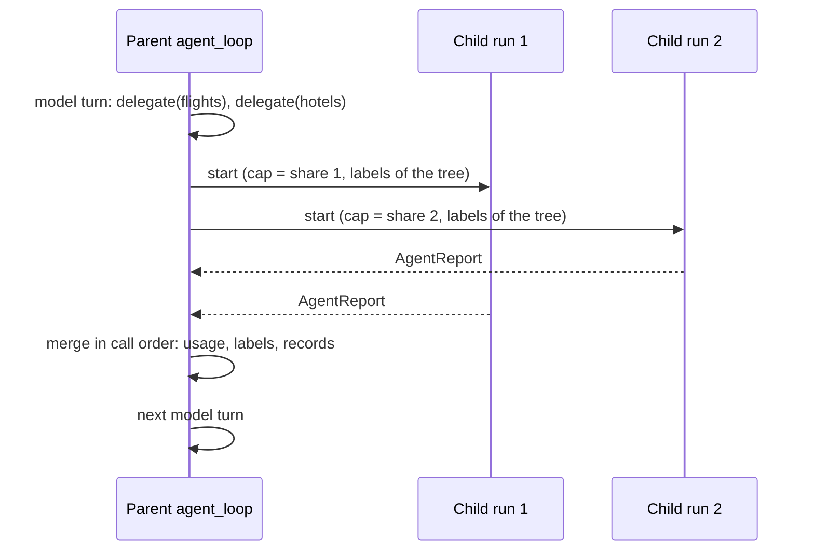

# ADR 0013: Concurrent agent children run as child runs

## Status

Accepted (issue #2270, epic #2262).

## Context

- An inline child of the agent mesh runs on the worker of its parent, in
  the history of its parent. Children of one turn run one after another.
  A planner that asks a researcher, a critic and a coder waits for each.
- The issue asked for a bounded fan-out of inline children, with the
  concurrent awaitables of the engine.
- `futures::join!` of single durable awaitables is safe. The determinism
  guide sanctions it (HVG005).
- A child is not one awaitable. It takes many steps: model turns, tool
  calls and approval waits.
- Replay pairs each command with the next recorded event of the same kind.
  It does not know which branch of a join sent the command.
- A simulator run shows the result. Two joined branches each run three
  activities with the same name. At seed 0, one branch reads a result of
  the other branch. The two children would swap their answers.

## Decision

1. A model turn with two or more `delegate` calls in a row runs them at
   the same time when `AgentTask::parallel_children` is 2 or more. The
   policy must allow each call, and each peer must be inline. The bound is
   `MAX_PARALLEL_CHILDREN`. A larger batch splits into runs of the bound.
2. Each child of a batch runs as a child `agent_loop` run, with its own
   history. The parent joins the child runs. A child run is one awaitable,
   so the join is the sanctioned form.
3. The siblings split what the tree has left with `sibling_cap`:
   - the token remainder, so the caps of the batch sum to the remainder;
   - the delegation remainder, so each child run counts its own
     delegations from zero.
4. Each child starts with the labels of the tree. The labels of each child
   join the tree when the batch ends. A sibling does not see the labels of
   another sibling. They share no context, so no data flows between them.
5. A single delegation, a gated one, or one to a durable peer runs inline,
   as before. A task with `parallel_children` 0 or 1 runs as before. A
   recorded task has no such field, so it replays as it ran.

## Consequences

- Replay of the parent is exact in any completion order. The simulator
  test `a_fan_out_replays_the_same_in_any_completion_order` proves it.
- A gated call in a child run waits on that child run. Send its approval
  to the child execution. The record of the delegation names its run id.
- A child run starts with no released flow rules. An `UntilApproved` rule
  asks again in the child.
- A durable agent takes an interrupt only after its batch ends.
- `eval::evaluate` answers each child run with the recorded report of the
  child with the same delegation chain and task text. With no match, the
  candidate fails. No child runs live.
- Each child run is a workflow, so it adds start and end events and a
  task row. Keep the bound low.
- The engine limit stays. Two joined branches that each take many steps
  can swap results. A fix belongs in the replay matcher, not in this crate.
