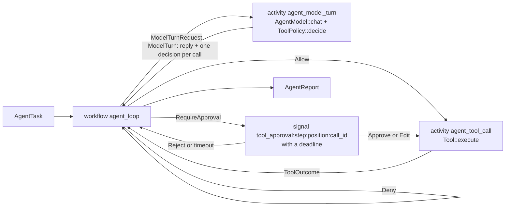
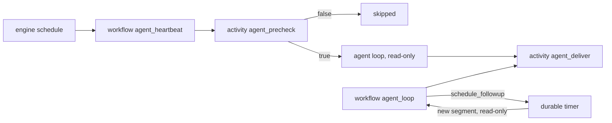

# Durable agents: the agent adapter

`autumn-harvest-agent` runs an agent as a durable workflow (issue #1973).
The agent loop is the workflow. Each model call and each tool call is an
activity. A human approval is a durable wait.

A crash costs at most the one step that was in flight. A restart reads every
completed model call, policy decision and tool call from history. It does not
pay for them again.

The crate owns its agent primitives: `AgentModel`, `Tool`, `ToolPolicy`,
`Approval` and the message types. They follow the shape of the
`autumn-plugin-agent` primitives, but the crate does not depend on it. It
depends on the core engine only, with no default features.
[ADR 0006](adr/0006-agent-adapter-framework.md) records why.

## 1. The mapping



| Agent concept | Engine primitive | What history records |
|---|---|---|
| The loop and its budgets | Workflow `agent_loop` | `AgentTask` in, `AgentReport` out |
| One model call | Activity `agent_model_turn` | The reply and the policy decision for each call |
| One tool call | Activity `agent_tool_call` | The tool result, cut to fit the result cap |
| "Ask a person first" | Signal with a deadline | The `Approval`, or the timeout |

## 2. Run it on SQLite

The example needs no API key and no network. It drives a run to its
approval wait, drops the runtime as a crash would, opens the file again,
approves, and finishes:

```sh
cargo run -p autumn-harvest-agent --features sqlite --example sqlite_agent
```

```text
waiting on tool_approval:0:1:write_1 for call Some("write_1")
  write_note ran with {"text":"remember the milk"}
stop:   Completed
answer: The note is saved.
model calls: 1 before the restart, 1 after it
```

The core of it:

```rust
use std::sync::Arc;
use autumn_harvest_agent::{AgentHarness, AgentTask, sqlite};
use autumn_harvest_sqlite::{RunState, SqliteRuntime};
use autumn_harvest_agent::Approval;

let mut rt = SqliteRuntime::open("agent.db")?;
sqlite::register(&mut rt, Arc::new(harness));
let exec = sqlite::start(&mut rt, &AgentTask::new("Save a note."))?;

if let RunState::WaitingSignal(signal) = rt.run_until_blocked(exec).await? {
    // Show the call to a person, then send the decision.
    sqlite::decide(&mut rt, exec, &signal, &Approval::Approve)?;
}
let state = rt.run_until_blocked(exec).await?;
```

The SQLite backend has no shared-state registry, so `sqlite::register`
captures the harness in synchronous closures. Each closure runs its async
body with `block_in_place`, so use a multi-thread Tokio runtime.

## 3. Run it on Postgres

Register the workflows and the activities. Install the harness as worker
state, because the activities read it with `ActivityContext::state`:

```rust
use autumn_harvest::builder::HarvestBuilder;
use autumn_harvest_agent::{AgentHarness, activities, workflows};

let harness = AgentHarness::new(client)
    .tool(lookup)
    .policy(Arc::new(ToolRules::new().effect(ToolEffect::Write, Rule::Ask)));

let built = HarvestBuilder::new()
    .workflows(workflows())
    .activities(activities())
    .state(harness)
    .build();
```

`workflows()` returns `agent_loop`, `agent_heartbeat` and the durable
`agent` (section 15). `activities()` returns `agent_model_turn`,
`agent_tool_call`, `agent_memory_snapshot`, `agent_deliver`,
`agent_precheck`, `agent_discover_peers`, `agent_profile`,
`agent_memory_reset`, `agent_workspace_retain`, `agent_workspace_reset` and
`agent_workspace_floor`.
The test `the_engine_registration_builds` builds this
exact registration.

Start a run under the name `agent_loop` with an `AgentTask` as input. To
decide on a gated call, send a signal to the run, with a serialised
`Approval` as the payload. Read the signal name from the wait: the
deadline timer of the wait is `__signal_timeout:<seq>:<signal name>`. On
SQLite, `RunState::WaitingSignal` holds the name. For a run with no
delegation, `approval::approval_signal(step, position, call_id)` also builds
it from the recorded `ModelTurn`. A worker with
no harness fails the call as `AgentHarnessMissing`, which is not retryable.

A worker with a payload cap other than the default must say so. Set
`AgentTask::max_request_bytes` to its activity-input cap, and
`AgentHarness::max_result_bytes` to its activity-result cap. A cap of zero
means no cap, as in the engine.

A worker with a payload store offloads an input or a result over the store
threshold. The engine then skips its cap for that value. The adapter does not
see the store, so it still applies its own caps. Set both caps to zero for such
a worker. Otherwise the adapter ends a run that the store could carry.

## 4. Build the harness

`AgentHarness` holds the parts that do real work:

- `new(model)` — any `AgentModel`. Implement its one `chat` method for your
  provider, or bridge a framework you already use. The crate ships no HTTP
  client.
- `tool(tool)` / `tools(iter)` — any `Tool`. `FnTool` wraps an async
  function.
- `policy(policy)` — any `ToolPolicy`. The default is `AllowAll`.
  `ToolRules` gives per-tool and per-effect rules.
- `temperature(t)` — the sampling temperature of each call.
- `tool_output_limit(chars)` — the cap on one tool result. The default is
  8 000 characters.
- `max_result_bytes(bytes)` — the activity-result cap of the workers. A
  larger tool result is cut to fit it. A model reply that does not fit ends
  the run as `reply_too_large`. The default is the engine default. Zero is
  no cap.
- `model_timeout(d)` — the time budget of one model call. The default is
  13 minutes. With the policy, cache and ledger budgets, it stays below the
  15-minute `start_to_close`. A call over it is a
  retryable failure.
- `tool_timeout(d)` — the time budget of one tool call. The default is
  9 minutes, below the 10-minute `start_to_close`. A call over it is an
  error result that the model reads.
- `policy_timeout(d)` — the time budget of the policy for all calls of one
  turn. The default is one minute. A call with no decision when the budget
  ends is denied, and the decision is recorded.
- `hook_timeout(d)` — the time budget of one memory read, delivery or
  precheck. The default is 30 seconds.
- `cache_timeout(d)` — the time budget of one response-cache call. The
  default is 5 seconds.
- `budget_timeout(d)` — the time budget of the LLM budget check of one
  turn (issue #1997). The default is 10 seconds. A check over it is a
  retryable failure, before the model call.
- `memory(store)` — the `MemoryStore` for runs with a memory scope.
- `delivery(delivery)` — where reports go. The default is `LogDelivery`.
- `precheck(precheck)` — the cheap check that can skip a heartbeat tick.
- `response_cache(cache)` — serve an identical model call across runs.
  Section 11 explains it.

The names `memory` and `schedule_followup` belong to the built-in tools.
When a built-in is active, it hides an app tool with the same name. With a
memory store installed, `memory` is always reserved, even in a run that gets
no memory tool. In a run with a mandate, `delegate` is reserved too. See
[agent mesh](agent-mesh.md).

A tool error is cut to fit the result cap too, so a huge error message
cannot fail the run.

### The cost ledger

Each model turn writes one row to the
[agent cost ledger](llm-cost-ledger.md) (issue #1996). The row holds the
model id, the tokens, the cost and the call latency. It is outside the
encrypted turn output, so the usage report can sum it per tenant. Two
`AgentModel` methods fill it in:

- `model_id()` — the model id, which the response cache also keys on. The
  default is `None`. The ledger stores the id in clear, so do not put PII
  in it. It takes a token of ASCII letters, digits and `._:/@+-`, and
  records `None` or any other id as `"unknown"`.
- `cost_usd_micros(usage)` — the cost of one call, in millionths of a US
  dollar. The default is `None`, which counts the call as unpriced.

A response cache hit calls no model and spends no tokens, so it writes no
ledger row.

The SQLite backend writes the same rows (issue #2275). `sqlite::register`
registers the model turn with `register_activity_with_ledger`, so the turn
returns its call with its output. The runtime writes the row in the
transaction that appends the turn, as Postgres does. A crash before that
commit writes no row, so a resumed run counts each turn once. Read the rows
with `SqliteRuntime::llm_ledger(exec)`, or `llm_ledger_between` for a time
window.

`AgentTask` sets the run. Its bounds are `max_steps` (default 8, per
segment), `max_total_tokens` (per run), `max_output_tokens`,
`approval_timeout` (default one hour, rounded up to whole seconds) and
`max_request_bytes` (the default is the engine default; zero is no cap). Its
content is `input`,
`system`, `history` and `session`. `tenant` scopes the response cache.
Section 10 explains the always-on settings: `deliver`, `memory`,
`followups`, `loop_guard`, `read_only`, `unattended` and
`unattended_memory_writes`.

The loop drops a system message inside `history`. Only `system` reaches
the model as the prompt.

## 5. Approvals

A call that the policy answers with `RequireApproval` waits on one signal.
The name is `tool_approval:<round>:<position>:<call_id>`. `round` counts the
tool rounds of the whole run tree. With no delegation, it is the step of the
run.
`approval::approval_call_id` reads the call id back from a name.

| Decision | Effect |
|---|---|
| `Approval::Approve` | The call runs as the model asked. |
| `Approval::Edit { arguments }` | The call runs with the reviewer's arguments. |
| `Approval::Reject { reason }` | The call does not run. The model reads the reason. |
| No decision before the deadline | The call does not run. The model reads that no approval arrived. |
| A payload that is not an `Approval` | The call does not run. The model reads that the decision was not readable. The run goes on. |

Each name belongs to one wait. A decision that arrives after its deadline
stays unread in history. It never releases a later call, even when the model
reuses a call id. Send each decision once: a second one changes nothing, but
a strict replay check can report it.

A signal payload is capped at 256 KiB, so keep edited arguments under that
size. The policy does not check edited arguments again. Whoever can send a
signal to the run can therefore run a gated tool with any arguments. Guard
the signal endpoint as you guard the tool.

## 6. What a crash costs

| In flight at the crash | On resume |
|---|---|
| Nothing | Nothing runs again. |
| A model call | That one call is sent again. Providers take no idempotency key. |
| A tool call | That one call runs again. Use `ToolContext::run_id`, `step` and `call_id` as an idempotency key. |
| An approval wait | The wait resumes. Its deadline is durable. |

Two tests prove the model-call and tool-call rows. Each one runs its own
binary as a child, which calls `abort` in the middle of the loop. The parent
opens the same database and finishes the run. A log that both processes write
shows what ran in each process.

- `crash_mid_loop_resumes_without_rerunning_completed_calls` aborts inside the
  second tool call. In the parent, only that tool call and the last model call
  run.
- `crash_inside_a_model_call_resends_only_that_call` aborts inside the second
  model call. In the parent, only that model call and what follows it run.

The policy runs inside the model-turn activity. Its decision is part of the
recorded reply, so replay never asks the policy again.

## 7. How a run ends

A bound is a normal end, not an error. `AgentReport.stop` names it:

| `stop` | Meaning |
|---|---|
| `completed` | The model gave a final answer. |
| `output_capped` | The last turn hit the output cap. Its tool calls do not run. |
| `steps_exhausted` | The model asked for tools after `max_steps` rounds. |
| `tokens_exhausted` | The run spent more than `max_total_tokens`, follow-ups included. |
| `transcript_full` | The next request would exceed the request cap. The request is not sent. |
| `reply_too_large` | The model reply exceeds the result cap, even with its decision reasons cut. The activity drops the reply. |
| `budget_exceeded` | A run or tenant LLM budget refused the next model call. The call was not sent. See [LLM budgets](#llm-budgets-issue-1997). |
| `loop_detected` | The loop guard saw the same call, with the same result, too many times. |
| `failed` | The run failed. `AgentReport.error` holds the error. Only a fan-out child ends so, because a parent keeps its usage and labels (issue #2328). |

A turn that ends the run before its tool calls run is left out of
`AgentReport.messages`. Its text is not the answer either. A round that ends
the run as `transcript_full` stays in the transcript. Each call that did not
run, or whose result did not fit, gets an error result, so the transcript
shows what ran. The text of that turn is not the answer either.

A `transcript_full` transcript is too large for one request. Do not pass it
whole as the `history` of a new run. Summarise it, or keep its last turns.
A run with `AgentTask::context_reset` can reset before it reaches the cap. See
[Context reset](#context-reset-issue-2453).

Retries follow `ErrorKind::is_retryable`. `RateLimited`, `Transport` and
`Unavailable` retry with backoff, up to four attempts. So does a model call
over its time budget. Every other kind fails the model call at once. Your
`AgentModel` picks the kind, so map a provider timeout, 5xx or overload to
`Unavailable`. A tool call runs once, and a tool error is a result that the model
reads.

The run fails when a model call fails for good: a non-retryable kind, for
example a rejected API key, or four failed attempts.

### Payload caps (issue #2040)

A tool round measures the whole next request before it runs a call. The
request holds the transcript, the assistant turn and an answer for each call.
The round reserves a placeholder answer for each call. It replaces the
placeholder with the real result.

- When the placeholders exceed the request cap, no call runs. No result can
  reach the model, so no call with a side effect runs. The run ends as
  `transcript_full`.
- The round drops a result that exceeds the cap. The call ran. The calls
  after it do not run. The run ends as `transcript_full`.

The measure covers the result text and the flow state that this turn can
add. A delegation adds the labels and usage of its child, which the round
cannot know in advance. The loop measures the next request again before it
sends it. It ends the run as `transcript_full` if that request exceeds the
cap.

A task recorded before this rule measures the results alone, so a run in
flight replays as it ran. Such a task also reads a zero request cap as a limit
of zero bytes, as it did. `AgentTask::new` and `HeartbeatTask::new` turn the
new rule on. A recorded tick keeps the flag in `HeartbeatTask`.

The model-turn activity fits its reply to the result cap:

1. It cuts each decision reason to 256 bytes. It does this only when the
   turn exceeds the cap.
2. When the reply still exceeds the cap, the activity returns a turn with
   `oversized` set and no content. The run ends as `reply_too_large`. The
   activity logs a warning with the sizes.

The report keeps the usage of the paid call. The reply is not in
`AgentReport.messages`. A result cap of 256 bytes or more always holds the
`oversized` turn. A smaller cap can still fail the activity with
`PayloadTooLarge`.

A cap of zero is no cap, as in the engine. This holds for
`AgentTask::max_request_bytes` and `AgentHarness::max_result_bytes`, in every
check above.

### LLM budgets (issue #1997)

`max_total_tokens` bounds one run inside the workflow. A budget on the
Postgres engine also bounds a tenant across runs, and it can bound cost.

Each model turn checks the budget before the call. The budget sums the
[cost ledger](#the-cost-ledger) rows of the run and of its tenant. The cost
caps are in millionths of a US dollar, as `cost_usd_micros` is. An unpriced
call adds no cost, so only the token caps apply to it. Price the cache
counts in `cost_usd_micros` if your provider bills them at another rate.

The ledger writes the calls of a completed attempt only. A call in an
attempt that fails or times out is not counted, even when the provider
charges for it.

The budget counts `input_tokens` plus `output_tokens`. `input_tokens` must
count the whole prompt, cached tokens included. Some providers report the
cached tokens apart, so add them to `input_tokens` in your `AgentModel`.

A response cache hit calls no model. It spends no tokens and records no
row. The budget check still runs before the cache lookup, so a spent cap
refuses a turn that the cache could answer.

A failed spend read retries the turn, and uses one of its four attempts.
The turn calls no model before the check passes, so the retry pays nothing.

Declare the caps on `agent_loop`, and set the tenant on each task:

```rust
use autumn_harvest::builder::HarvestBuilder;
use autumn_harvest::quota::QuotaPolicy;
use autumn_harvest_agent::AgentTask;
use autumn_harvest_agent::workflow::{activities, agent_loop_info};

let budget = QuotaPolicy::new("tenant")
    .with_max_run_llm_tokens(200_000)
    .with_max_tenant_llm_cost_usd_micros(50_000_000) // 50 US dollars a day
    .with_tenant_llm_window_secs(86_400);
let built = HarvestBuilder::new()
    .workflows(vec![agent_loop_info().with_quota(budget)])
    .activities(activities())
    .state(harness)
    .build();

let task = AgentTask::new("Summarise the ticket.").tenant("acme");
```

Register `agent_loop` with its policy on every worker that runs
`agent_model_turn`. The check reads the policy in its own process. A worker
without it does not enforce the budget, and logs one warning.

A spent cap refuses the next model turn. The adapter does not send the call,
and the run ends under `budget_exceeded`. Three limits apply:

- The cap is soft. The last turn that passes the check can pass the cap by
  its whole usage. Runs of one tenant at the same time can pass it
  together.
- A task with no `tenant` has no tenant budget. Its run caps still apply.
- The budget reads `AgentTask::tenant` as the task gives it. It does not
  read the verified tenant (#1977), as the response cache does.
- The SQLite backend rejects a workflow that declares `quota`. A budgeted
  `agent_loop` therefore does not build there.

## 8. History types

The adapter owns the payloads it records: `AgentTask`, `ModelTurnRequest`,
`ModelTurn`, `ToolCallRequest`, `ToolOutcome`, `AgentReport`,
`HeartbeatTask`, `HeartbeatReport`, `Report`, `ReportSource`,
`MemoryScope`, `Followups`, `LoopGuard`, `Mandate`, `Peer` and
`DelegationRecord`. They hold only types this crate
defines, so the crate owns their serde shape. Replay reads these payloads
back, so add a field only with `#[serde(default)]`. A new field of an
activity input also needs `skip_serializing_if` at its default, because a
strict replay compares each recorded input as it was written.

### 8a. Transcript deltas (issue #2264)

A model turn records only the messages that it adds. Its input names the
earlier window with a `PrefixRef`: a chained SHA-256 digest of the messages
and their count. The model-turn activity reads that window from the
`TranscriptStore` of the harness, adds the new messages, and keeps the
result for the next turn.

| Case | What happens |
|---|---|
| First turn of a run | The full form. The activity keeps the window. |
| A later turn | A delta on the window that the last turn sent. |
| A new segment or op | A delta when the window still starts with the last sent window. A trimmed transcript is sent in the full form. |
| The store misses | The turn fails with `TranscriptPrefixMissing` before any model call. The workflow sends it again in the full form. |

- The model reads the same window in both forms. The response cache key
  and provider prompt caching do not change.
- The request cap still measures the whole window, so the full form always
  fits.
- `AgentTask::new` turns the delta on. `transcript_delta(false)` turns it
  off. A task recorded before the change has no flag, so it replays as it
  ran.
- The default store is an `InMemoryTranscriptStore` with a 64 MiB bound. A
  restart empties it, so each run sends the full form once. Set a shared
  store with `AgentHarness::transcript_store` to hit on every worker.
- A read checks the digest of the window. A store that hands back a
  changed window is a miss, and the turn goes in the full form.
- A store holds transcript text outside history and outside the payload
  codecs. An erasure does not reach it, because `TranscriptStore` has only
  `get` and `put`. The app must clear its own store when it erases a run.

A 50-turn run with a 1 KB tool result each turn stores about 86% less
history (`a_50_turn_run_stores_at_least_80_percent_less_history`).

## 9. Limits

- **Each turn records its new messages.** A turn records a prefix
  reference and the messages that it adds (section 8a). History still
  grows with each turn, so a long session should continue as new with the
  report's `messages` as `history`.
- **Live text is a side channel.** An activity result is still one value.
  `AgentTask::stream` sends live text beside it, and nothing stores that
  text. See "Live tokens" in section 15.
- **Tool definitions are read at call time.** A deploy that changes the tool
  list changes only later turns. Recorded turns replay as they were.
- **A follow-up chain shares one workflow history.** Each segment adds to
  it. Keep `max_chain` low, or start a new run from the report.
- **A late reply or approval stays unread.** A durable agent never takes
  a promise or approval signal whose wait ended, and a checkpoint carries
  it to the next run. Such signals add bytes for the life of the agent.

## 10. Always-on agents

An always-on agent wakes on a schedule, books its own follow-ups, keeps
notes, and speaks only when something needs attention. Five primitives do
this. Each one maps onto an engine primitive, so a crash costs no more than
it does in a plain run.

| Primitive | Engine primitive | Turn it on |
|---|---|---|
| Heartbeat | Workflow `agent_heartbeat`: one tick per run | `heartbeat::schedule` (Postgres), `sqlite::start_heartbeat` |
| Follow-up | A durable timer, then a new segment in the same workflow | `AgentTask::followups` |
| Delivery | Activity `agent_deliver` | `AgentTask::deliver`, `AgentHarness::delivery` |
| Memory | Activity `agent_memory_snapshot`, once per segment | `AgentTask::memory`, `AgentHarness::memory` |
| Loop guard | A fingerprint of each recorded call, in the workflow | On by default: `AgentTask::loop_guard` |



### Unattended runs are read-only

No person watches a heartbeat tick or a follow-up segment. Both are
read-only by default:

- The policy denies a tool with the `Write` or `External` effect, and a tool
  that the harness does not know. The model reads why.
- The tool-call activity checks the effect again before it runs a tool.
- The run cannot write its memory. A note from a run that read untrusted
  data would reach the system prompt of every later run in the scope.

`HeartbeatTask::allow_actions` and `Followups::allow_actions` lift the
first two rules only. The memory rule has its own opt-in:
`HeartbeatTask::allow_memory_writes` or `AgentTask::unattended_memory_writes`.
`AgentTask::read_only` applies all three rules to any run.
`AgentTask::unattended` applies the memory rule.

### Heartbeats

A tick is one short workflow:

1. The `Precheck` runs. A `false` answer ends the tick with no model call.
   Use it to look for new work, for example an unread inbox. A precheck over
   the hook budget skips the tick.
2. The agent loop runs the heartbeat prompt. The default prompt tells the
   model to reply with exactly `HEARTBEAT_OK` when nothing needs attention.
3. The workflow delivers the answer, unless it is a silent acknowledgement:
   `HEARTBEAT_OK` with no other letter or digit.

A tick never books a follow-up. `HeartbeatTask` takes its own budget:
`max_steps`, `max_total_tokens`, `max_output_tokens`, `max_request_bytes`
and `approval_timeout`. Set `max_request_bytes` to the activity-input cap
of the workers, as for `AgentTask`. The approval wait defaults to 15
minutes, because the schedule starts no new tick while one runs.

On Postgres, register the schedule that `heartbeat::schedule` builds:

```rust
use std::time::Duration;
use autumn_harvest::builder::HarvestBuilder;
use autumn_harvest::policy::Schedule;
use autumn_harvest_agent::heartbeat::{self, HeartbeatTask};
use autumn_harvest_agent::{AgentHarness, activities, workflows};

let tick = HeartbeatTask::new().system("You watch the build queue.");
let every_30_minutes = Schedule::Interval(Duration::from_secs(1_800));
let built = HarvestBuilder::new()
    .workflows(workflows())
    .activities(activities())
    .workflow_schedule(heartbeat::schedule(every_30_minutes, &tick)?)
    .state(AgentHarness::new(model))
    .build();
```

On SQLite, pass the same `heartbeat::schedule` to
`SqliteRuntime::upsert_schedule` (issue #2031). An app can also call
`sqlite::start_heartbeat` on each tick.

The engine keeps one schedule per workflow name, so a deployment has one
heartbeat schedule. For one heartbeat per agent, use a durable `Agent`
(section 15). Each agent key has its own heartbeat, driven by its own
durable timer, and a tick is an op in its inbox. A deployment can run any
number of them.

### Follow-ups

A task with `AgentTask::followups` gives the model the `schedule_followup`
tool. The tool takes a `prompt` and a `delay_minutes`. When the segment
completes, the workflow waits on a durable timer. Then a new segment runs
in the same conversation.

The model wrote the prompt, maybe under the influence of a tool result. So
the prompt never goes into a user message. It stays in the model's own
`schedule_followup` call, an assistant message. The new segment starts with
a fixed user message that the app controls, which tells the model to act on
that call.

- The workflow refuses a second follow-up in one segment.
- The prompt is at most 2 000 characters. The count includes white space,
  because the transcript keeps the prompt as the model wrote it.
- The delay is at most the `max_delay` of `Followups::new`. The shortest
  delay is one minute. A durable agent counts the delay from the end of the
  segment, so a long segment never books a follow-up that is already due.
- A chain cap (`Followups::max_chain`, 10 by default) stops an agent that
  wakes itself forever.
- A segment that ends under any stop other than `completed` runs no
  follow-up. The report then sets `followup_dropped`.
- `max_total_tokens` and the loop guard cover the whole chain. `max_steps`
  counts each segment from zero.
- Approval names and `ToolContext::step` count steps across segments, so
  they never repeat. The report covers the whole run.

A restart during the wait resumes the timer. It sends no report again and
asks the model nothing again.

### Delivery

`AgentTask::deliver` sends the result of each segment to the `Delivery` on
the harness. The default `LogDelivery` logs the run id and the size of the
text, never the text itself.

- A `completed` answer goes out, unless it is empty or a silent heartbeat
  acknowledgement. Only the text of the last turn counts. A segment that
  ends on an empty turn sends nothing, even when an earlier turn wrote
  text beside a tool call. An empty `output_capped` turn sends only the
  stop notice. A run recorded before this rule replays as it ran. The
  workflow records the `agent_final_turn_rules` patch marker to tell them
  apart. The follow-up length rule uses the same marker.
- A segment that a bound ended early sends a notice, for example
  `The agent stopped early: loop_detected.`. An unattended run therefore
  does not fail in silence.
- A failed delivery never fails the run.

The workflow sends each report once, and replay does not send it again. The
activity itself can retry, for example after a send that timed out. So a
`Delivery` that must not repeat a message dedupes on `Report::key()`: the
run id and the segment. The run id is the execution id, so a later run
under the same workflow id gets new keys. A task recorded before this
change has no `run_id_source` field. It keeps the workflow id, so its run
replays as it ran. A task built from JSON can set
`"run_id_source": "execution_id"`.

### Memory

`AgentTask::memory` gives the run a memory scope, and the model a `memory`
tool to add, replace and remove entries. The store is a `MemoryStore` on
the harness. `InMemoryMemoryStore` suits tests. Use a durable store in
production. A run with a scope and no store fails as `MemoryStoreMissing`.

An activity reads the snapshot once per segment. The workflow adds it to
the system prompt. A write during the segment goes to the store at once,
but the prompt does not change until the next segment. A stable prompt
keeps provider prompt caching working, and replay reads the recorded
snapshot.

The snapshot escapes each entry onto one line, so an entry cannot close its
block or add a prompt section. The snapshot tells the model that the
entries are its own notes, not instructions from the user.

Each edit carries an `EditKey`: the run, the step and the call. A store
applies each key once, so a call that runs again after a crash changes
nothing, even when another run edited the scope in between. A store keeps
the first result of a key, an error included, and returns it on a retry. A
failed `remove` therefore cannot remove a newer entry after a crash. A
durable store must save the key and its result with the edit, in one
transaction. An `add` of an entry that already exists changes nothing
either.

### Loop guard

The loop guard counts identical calls: same tool, same arguments, same
result. With the defaults, the third identical call in the last 30 calls
adds a warning to its result. The fifth stops the run as `loop_detected`,
and no later call in that round runs. One guard covers the whole run,
follow-ups included. `LoopGuard::disabled()` turns it off. A recorded task
with no `loop_guard` field decodes with the guard off, so a run started
before the guard existed replays as it ran.

The guard is not a cost control. A model that changes its arguments, or a
tool whose result changes, does not trip it. Use `max_steps`,
`max_total_tokens` and the chain cap for cost.

### Context reset (issue #2453)

A long run can save its progress and restart from it, after CORAL. The
setting is off by default.

```rust
use autumn_harvest_agent::{AgentTask, ContextReset};

// Up to 2 resets, each before a request that reaches 80 % of the cap.
let task = AgentTask::new("audit the ledger")
    .context_reset(ContextReset::new(2, 80).max_notes_bytes(4_096));
```

- The model gets the `save_progress` tool. Its `notes` argument replaces
  the notes of the run. The workflow handles the call, so no activity runs.
  Replay reads the call from the recorded model turn.
- Notes over `max_notes_bytes` get an error result. The earlier notes stay.
  The default bound is 8 192 bytes.
- Before each request, the loop measures it against the request cap of
  [Payload caps](#payload-caps-issue-2040). When the request reaches
  `reset_at_percent` of the cap and a reset is left, a reset is due. 0 counts
  as 1, and a value over 100 counts as 100. A zero cap is no cap, so it never
  resets. A reset whose window still reaches the threshold frees no room, so
  it does not run.
- A due reset first asks for a save turn. The loop sends the window with the
  fixed notice `RESET_NOTICE`. The model reads the last round, and only
  `save_progress` runs in that turn. Each other call gets an error result. The
  reset runs before the next request. When the notice does not fit the cap,
  the reset runs at once.
- The new window is the system prompt and `AgentTask::input`. The last
  `schedule_followup` call with its result, and the wake message of a
  follow-up segment, follow. Then the notes and the steers of a durable agent
  op follow.
- The notes are the model's own `save_progress` call, with a fixed result.
  The model wrote them, maybe under the influence of a tool result, so they
  never go into a user message.
- `max_resets` counts per run, follow-ups included. With no reset left, the
  run ends as `transcript_full`, as before. `AgentReport::resets` counts the
  resets. A report with no reset does not write the field.
- A reset changes only the transcript. The flow labels belong to the run, so
  a reset clears no taint.
- A delegated child takes the setting and starts with no notes. Its resets
  are its own. `DelegationRecord::resets` counts them.
- The reset reads only recorded data, so replay takes the same reset. The
  next turn after a reset goes in full, not as a delta.

A tool round that passes the cap in one step still ends as `transcript_full`.
The reset runs only before a request. A task with no `context_reset` field
takes no new path, so a recorded run replays as it ran.
`formal/verus/src/agent_reset.rs` proves that a request over the cap always
reaches the threshold, and that no run passes `max_resets`.
`docs/design/DESIGN-2453.md` records the design.

## 11. Response cache

Replay reads an answer from the history of one run. A second run that sends
the same request pays again. The response cache (issue #1998) serves that
request from an earlier answer. It is off by default.

```rust
use std::sync::Arc;
use std::time::Duration;
use autumn_harvest_agent::{AgentHarness, InMemoryCacheIndex, ResponseCache};

// Add the codecs to the builder first. Clones share their keys.
let codecs = builder.payload_codecs().clone();
let cache = ResponseCache::new(store, Arc::new(InMemoryCacheIndex::default()), codecs)
    .max_age(Duration::from_secs(24 * 3600));
let harness = AgentHarness::new(model).response_cache(cache);
```

**The key.** The key is a SHA-256 hash of the model id, the output cap, the
temperature, the tools, the messages, the tenant and its source, and the
namespace.

**The model id.** A model names itself through `AgentModel::model_id`. A
model with no id is never cached. The crate ships no model with an id. The
id must change whenever the answer can change for the same request. Use a
pinned model version, not an alias such as `latest`. Put each client setting
that `ChatRequest` does not hold, such as `top_p`, in the id.

**The tenant.** The default scope is `CacheScope::Tenant`. Only runs of the
same tenant share an entry. Runs with no tenant share only with each other.
A declared tenant never shares an entry with a verified tenant of the same
name.

| Backend | Tenant of the key |
|---------|-------------------|
| Postgres, run with a verified tenant (#1977) | The verified tenant. `AgentTask::tenant` cannot change it. |
| Postgres, run with no tenant | `AgentTask::tenant`, as a declared tenant |
| Postgres, the tenant read fails | No key. The turn skips the cache. |
| SQLite | `AgentTask::tenant`, as a declared tenant |

`HeartbeatTask::tenant` sets the tenant of each tick. `CacheScope::Shared`
lets every run share every entry. Use it only for prompts that hold no
tenant data.

**History.** A hit is the result of `agent_model_turn`. History records it
like any other answer, with `cache_hit: true` and zero token usage. The
policy still decides each tool call, and each tool still runs. Replay reads
history and never reads the cache.

**Tool idempotency.** A hit repeats the tool-call ids of the stored answer.
Tools take the run id, the step and the call id as an idempotency key. With
`RunIdSource::WorkflowId`, two runs can share a run id. On Postgres, such a
turn skips the cache. On SQLite, start each run from `AgentTask::new`, which
uses the execution id.

**Storage.** The answer goes to your `PayloadStore`, inside a codec
envelope. Pass a clone of the engine's `PayloadCodecs`, so an active codec
encrypts each entry. A registry with no active codec stores entries in
clear. The entry holds the answer and no prompt. Use a store for the cache
alone, with an expiry of at least `max_age`. Do not put an expiry on the
store that holds offloaded event payloads.

**The index.** A `CacheIndex` maps each key to its blob. `InMemoryCacheIndex`
keeps the map in process memory, with a capacity. It loses the map on a
restart, and each worker has its own map. Implement `CacheIndex` to share
one map between workers:

- `get` returns the blob key of an entry, if any.
- `put` stores a blob key, and returns each blob key that no entry holds
  after the write. The cache deletes those blobs.
- An index owns its blobs. Do not let a store share one blob between two
  indexes.

**Faults.** A cache fault, a slow cache or an entry that does not decode is a
miss with a warning. An out-of-date entry is a quiet miss. The cache never
fails a turn. Each cache call, the tenant read included, has the
`cache_timeout` budget: 5 seconds by default. One turn makes at most three
cache calls. The cache neither stores nor serves a turn over
`AgentHarness::max_result_bytes`, because a cached turn over the cap would end
every identical run as `reply_too_large`. A hit over the cap is a miss, and
the harness asks the model. A codec error is logged with fixed text,
because a custom codec can quote the answer.

**Limits.**

- A hit repeats one sample. At a high temperature, a second run gets the
  same answer.
- `max_age` limits what the cache serves, not what the store keeps. Change
  `namespace` to make every old entry a miss. The old blobs stay in the store
  until the index drops them.
- PII erasure (#495) does not reach the cache. Bound it with `max_age` and a
  store expiry.
- Key rotation (#948) does not re-encrypt entries. An entry under a retired
  key is a miss. Its blob stays until a new answer replaces it or the store
  expires it.
- Two runs that miss at the same time both call the model.
- A run that sets `tenant` records it in each model-turn input. An older
  binary rebuilds that input without it, so set `tenant` only after the
  whole fleet runs this release.

## 12. Evaluate a candidate model or prompt

`eval::evaluate` re-drives a recorded `agent_loop` run with a candidate model
or prompt (issue #2001). It reports where the decisions of the two runs
diverge. Turn on the `eval` feature.

```rust,ignore
use autumn_harvest_agent::eval::{Candidate, evaluate};

// The source history, for example from SqliteRuntime::load_history.
let history = rt.load_history(exec)?;
let candidate = Candidate::new(AgentHarness::new(new_model).tools(tools))
    .system_prompt("Answer in one sentence.");
let evaluation = evaluate(&history, &candidate).await?;
if let Some(turn) = evaluation.first_divergence {
    println!("{:?}", evaluation.turns[turn]);
}
```

The harness runs the real loop in the in-memory test engine. It writes
nothing to a database. The source history is a borrowed slice, so it cannot
change.

| Activity | In an evaluation |
|---|---|
| `agent_model_turn` | The candidate model answers, then the candidate policy decides. These are the only live calls. The response cache is skipped, so every turn asks the candidate. |
| `agent_tool_call` | The recorded outcome of the same call, or an error stub. No tool runs. |
| `agent_memory_snapshot` | The recorded snapshot, or an empty one. |
| `agent_deliver` | A stub. No report leaves the harness. |
| `agent_discover_peers` | The recorded peers for the same names, or none. The candidate needs no roster. |
| A child run of a fan-out | The recorded report of an unused child run with the same delegation chain and task text. With no match, the candidate run fails. No child runs live. |
| Any other activity, such as `agent_precheck` | No mock. The candidate run fails. |

A tool, snapshot or peer-lookup activity that failed the source fails the
candidate at the same activity.

The policy runs live, so use a policy with no side effects. It sees the
recorded run id and the aligned call ids. A retryable model failure retries
under the retry policy of `agent_model_turn`, as on a worker. A turn over the
harness result cap (`AgentHarness::max_result_bytes`) is cut or dropped, as on
a worker with no payload store. A dropped reply reads as a `stop` divergence.

A recorded outcome answers a call with the same step, tool name and
arguments. A candidate call that equals the recorded call at the same turn
and position, of the same agent, takes the recorded call id. Approval signal names hold the call
id, so the recorded approvals stay valid. Any other call gets a new `eval_`
id, so no recorded approval can release it. The harness sends again only an
approval for a wait that the source opened, when it arrived before the
deadline. An approval sent before its wait opened leaves no deadline timer,
so the harness drops it, and the candidate times out at that wait.

The report holds one `TurnDiff` per model turn. A turn diverges when the
calls, the arguments, the policy decisions or the stop reason differ. Two
final answers with the same stop reason and different text get `Reworded`.
That is not a divergence. `end_diverged` compares how the two runs end, for
example `Completed` and `TokensExhausted`. `diverged()` reads both.
`stubbed_tool_calls` counts the calls with no recorded outcome.

### Compare two models

`eval::compare` runs two candidates on one source (issue #2271). It returns
both evaluations and one `TurnDiff` per turn of the two candidates. In that
diff, `recorded` holds the first candidate.

```rust,ignore
use autumn_harvest_agent::eval::{Candidate, compare};

let harness = Arc::new(AgentHarness::new(fallback).model_named("a", a).model_named("b", b));
let first = Candidate::shared(Arc::clone(&harness)).agent_model("planner", "a");
let second = Candidate::shared(harness).agent_model("planner", "b");
let comparison = compare(&history, &first, &second).await?;
```

`Candidate::model` sets the model of every turn. `Candidate::agent_model`
sets the model of one agent of a delegation tree and wins over it.

Each candidate turn is a live model call. `Candidate::max_turns` caps them.
The default cap is the recorded turn count plus `DEFAULT_EXTRA_TURNS`. The
report sets `turn_cap_reached` when the cap stops the candidate. Each engine
cycle replays the history so far, so the time of an evaluation grows with the
square of the run length.

The harness refuses an erased source, a source that has not ended, a source
that was cancelled or timed out, and a history that is not an agent run. A history with payload-store references or
encrypted payloads needs decoding first. The model call blocks in place, so
run the evaluation on a multi-thread Tokio runtime.

The evaluation is an in-memory fork at the first event. The database fork of
issue #2000 is a separate feature.

## 13. The daemon example

`examples/claude-agent-daemon` speaks the Anthropic Messages API and replays
thinking blocks verbatim, which the provider-neutral `ChatMessage` cannot
carry. It therefore keeps its own turn activity. It takes three parts from
this crate: the approval signal names, the durable approval wait
(`approval::await_decision`), and the payload-cap checks.

`examples/autoresearch` runs `agent_loop` as a child workflow of each
experiment. It uses a mandate with a reviewer peer, a flow rule, approvals,
memory, delivery, a heartbeat with a precheck, the response cache and
`eval`. Its runs share a memory scope, so each run starts with the flow
labels of the runs before it. Its `edit_train` tool keys each edit on the
run, the step and the call id. Its `FileCacheIndex` implements `CacheIndex`
on disk, so a model call whose result a crash lost is not paid twice.

## 14. Agent mesh

A run can delegate a task to a peer agent. The peer runs as a sub-agent
inside the same workflow, with its own prompt, tools and budget. With
`parallel_children`, the delegations of one turn run at the same time, each
as a child run. They split the token remainder with `bounds::sibling_cap`.
A mandate bounds the delegation tree. Flow rules gate a dangerous sequence
of tool calls across the tree. Read [`agent-mesh.md`](agent-mesh.md).

## 15. Durable agents

An `Agent` (issue #2263) is a named, long-lived actor. It owns its state,
handles one message at a time, and survives a crash. It is the agent loop
inside a keyed entity (ADR 0006). The design is in
[`docs/design/DESIGN-2262.md`](design/DESIGN-2262.md).

| Agent concept | Harvest part |
|---|---|
| Address | `AgentId`, `<kind>/<name>`. It is the workflow id of the workflow `agent`. |
| Inbox | `AgentOp` values on the signal `harvest.entity.op` |
| Config | One `AgentProfile` for each kind, on the harness |
| One op | One segment of the agent loop, with the whole harness |
| State | `AgentState`: the transcript, the flow labels and the counters |
| Checkpoint | Continue-as-new. The state rides in the input. |

```rust
use autumn_harvest_agent::{AgentHarness, AgentId, AgentOp, AgentProfile, sqlite};

let harness = AgentHarness::new(model)
    .tool(lookup)
    .agent(AgentProfile::new("support").system("You answer support mail."));
sqlite::register(&mut rt, Arc::new(harness));

let id = AgentId::new("support", "acct-42")?;
sqlite::send(&mut rt, &id, &AgentOp::message_with_id("Where is my order?", "m-1"), Some("m-1"))?;
sqlite::drive(&mut rt, &id).await?;
let state = sqlite::state(&rt, &id).await?;
```

On Postgres, send a signal-with-start to the workflow `agent`. Use the agent
id as the workflow id, `{}` as the start input, and `Agent::payload(&op)` as
the signal payload. Pass the message id as the idempotency key.

### The inbox

| Op | Effect |
|---|---|
| `user_message` | Runs one segment with the text as the user message. |
| `control: pause` | Holds each later message in the state. |
| `control: resume` | Runs the held messages in order, then takes new ones. |
| `control: reset_memory` | Clears the memory: the scope `agent:<id>`, or the state memory. |
| `control: clear_transcript` | Clears the transcript. Only the labels of the memory and of the workspace files stay (issues #2272, #2274). |
| `control: reset_workspace` | Deletes every workspace snapshot of the agent (issue #2274). |

A control op applies at once, also while the agent is paused. The kernel
`agent::inbox::admit` makes the choice. Verus proves it, see
`formal/verus/src/agent_inbox.rs`.

### Guarantees

- One op runs at a time. A second message waits for the first reply.
- An acknowledged message is never lost. A paused agent holds it, and runs
  it on resume. A full held queue (256 ops) refuses an op and names it in
  `AgentState::last_error`.
- Replay rebuilds the transcript. A restart asks no recorded model call
  again.
- A failed op keeps the transcript as it was. It keeps the flow labels and
  the tokens that its tools and turns used.
- Each segment gets the run id `<incarnation>:s<n>`. The incarnation is a
  recorded id of this life of the agent, so a delete and a new start never
  reuse a tool idempotency key. The state carries the tool-round counter, so
  approval names never repeat.
- The transcript keeps at most `AgentProfile::window` messages. The cut
  lands on a user message.

### Heartbeats and follow-ups (issue #2266)

A wake is an op in the inbox, so it never runs at the same time as a
message. `Entity::run_with_wakes` races the op signal against the next
deadline of the agent. A due wake runs before a waiting message.

| Wake | Config | Op |
|---|---|---|
| Heartbeat | `AgentProfile::heartbeat`, or `Control::SetHeartbeat` for one agent | `HeartbeatTick` |
| Follow-up | `AgentProfile::followups`, then the model calls `schedule_followup` | `FollowupDue` |

- A tick is unattended. It is read-only unless `AgentHeartbeat::allow_actions`
  is set. It can ask the harness precheck first. A silent `HEARTBEAT_OK`
  tick leaves the transcript as it was and delivers nothing.
- The next tick is due one interval after a tick ends. A late tick never
  piles up, and a tick that runs longer than its interval lets the waiting
  ops run first. `agent::wake::next_heartbeat` books it, and a tick always
  books the next one after the time it ran.
- `Control::SetHeartbeat` can only narrow the profile, because any client
  that can signal the agent can send it. A flag holds only when the
  profile heartbeat sets it. Each bound is at most the profile bound. The
  interval is at least `MIN_CUSTOM_HEARTBEAT_SECS` (60 s), or the profile
  interval when that is shorter.
- A follow-up is a deadline in the state. The chain count is state too, so
  `Followups::max_chain` holds across a checkpoint. A message from a person
  starts a new chain.
- A paused agent skips its ticks, and a booked follow-up waits. On resume,
  one due tick runs.
- `HeartbeatTick` and `FollowupDue` do not decode from a signal.
- A restart during a wait resumes the timer. A tick and its report happen
  once.

### Lifecycle (issue #2267)

**Idle.** An agent that waits for its inbox or a timer is a row in the
database. No worker must hold it in memory. A fresh worker, or a fresh
SQLite runtime, serves its next message and its next wake. With resident
workflows on, a worker can keep a waiting run as a cache. The cache is
bounded, and a worker can drop an entry at any time. See `resident.rs` in
the [module guide](architecture.md).

**Search attributes.** Each op upserts `agent_kind`, `agent_status`
(`running`, `waiting_approval`, `idle`, `paused` or `parked`),
`agent_last_active_at`, `agent_next_wake_at`, `agent_wake_reason`,
`agent_tenant`, `agent_mesh` and `agent_tokens_used`. Times are epoch
milliseconds. The `filter` grammar of `GET /workflows` lists by them. The
index `idx_harvest_we_agent_wake` serves a range on `agent_next_wake_at`,
so a list of the agents due to wake reads only those agents.

**Operate.** `harvest agents` composes the generic management routes:

| Command | Route |
|---|---|
| `harvest agents list --status idle --wakes-before <ms>` | `GET /workflows?state=RUNNING&filter=workflow_name = 'agent' AND ...` |
| `harvest agents describe <kind>/<name>` | `GET /workflows/by-id/agent/{id}/query/harvest.entity.state` |
| `harvest agents pause <id> --reason <text>` | `POST /workflows/by-id/agent/{id}/signal/harvest.entity.op` |
| `harvest agents resume <id>` | the same route, with `resume` |
| `harvest agents erase <id>` | the signal route, then `POST /workflows/{exec}/erase-payloads` for each run |

**Erase.** `harvest agents erase` erases an agent and prints one report.
It removes the history payloads, the entity state, the memory, the
workspace, the stream chunks and the cost ledger rows. It does not reach
a `TranscriptStore` (section 8a) or the response cache (section 11). The
app must clear those stores itself.

1. The agent gets `pause`, `reset_memory` and `reset_workspace`, then a
   delete. The pause holds new work and stops the ticks, so nothing writes
   the stores after the resets. The resets clear a `MemoryStore` scope and
   every workspace snapshot, with the scratch files of stopped puts. See
   "Scratch files" and "A save after a reset" below for the two windows
   that stay. An agent that ended gets a new run for them,
   through `POST /workflows/agent/signal-with-start` on the queue of its
   last run. The command waits for the run to end.
2. The command compares the failure count of the final state with the
   count before the resets. A new failure sets `stores_reset: false`, and
   `stores_error` names the error.
3. The command lists each run of each life of the agent with
   `filter=workflow_name = 'agent' AND workflow_id = '<id>'`.
4. It erases each run. The erasure tombstones the payloads of history, the
   entity state and its projection, and deletes the stream chunks and the
   cost ledger rows. It cascades to each child run of a fan-out.
5. The report sums each count over every run and child:
   `events_scrubbed`, `stream_chunks_deleted`, `ledger_rows_deleted`,
   `entity_states_scrubbed` and the rest. It lists each skipped child and
   each failure.

The spend of an erased run leaves the LLM budget and mesh budget sums.

### Mid-turn messages (issue #2265)

A message carries an `Urgency`. `sqlite::send` sends the extra signal first,
then the op. On Postgres, send the signal of `Agent::urgency_signal(&op)` to
the running run, then the op.

| Urgency | Signal | Effect |
|---|---|---|
| `queue` | none | The message runs after the current op. |
| `steer` | `agent.steer` | A running segment adds the text before its next model turn. The op is then a no-op. With no op running, the op runs the message once. |
| `interrupt` | `agent.interrupt` | The current op stops. The message runs next. |

What an interrupt does to the work in flight:

| In flight | Effect |
|---|---|
| A model turn | The race cancels it. The op ends as `interrupted`. |
| A tool call whose tool opts in (`Tool::interruptible`) | The race cancels it. The call answers that it was cancelled. |
| Any other tool call | It runs to its end. No later call of the round runs. |
| An approval wait | It ends as a rejection. The tool does not run. |

The race records its winner, so replay takes the same branch and asks no
model again. An interrupt that arrives while no op runs is stale, and the
next op drops it. On SQLite a running activity never sees a cancel: the
workflow takes the interrupt, and the activity result is dropped.

### Memory as state (issue #2273)

`AgentProfile::memory(AgentMemory::State)` keeps the memory blocks in
`AgentState::memory`. The workflow runs the `memory` tool itself. An edit is
part of the op, so it commits with the op snapshot. A crash replays the op,
and the edit lands once. No store and no edit key are involved.

- The system prompt of an op holds the memory as it was when the op
  started. An edit shows from the next op, so a provider prompt cache keeps
  its prefix.
- The memory lives in the entity snapshot events and in the
  `harvest_entity_state` projection. Erasure and codec rotation cover both
  (issue #2259).
- `AgentMemory::Store` keeps the `MemoryStore` of the harness for an agent
  that shares memory with other runs.

`autumn-harvest-agent/examples/agent_session_entity.rs` runs a chat session
as an agent.

### Progress notes (issue #2453)

`AgentProfile::context_reset` gives each op the
[context reset](#context-reset-issue-2453). The agent keeps its notes in
`AgentState::notes`, with the flow labels of the op that saved them.

- Each op shows the notes after its input, as a `save_progress` call and its
  result. `trim_window` drops old turns, but the notes stay.
- The transcript in the state holds no copy of the notes. The first turn of
  an op with notes therefore goes in full, not as a delta.
- An op that reads the notes takes their labels, so the taint follows the
  text.
- Only a segment that may write memory keeps its notes past the op. A
  read-only op, a heartbeat tick, a follow-up and a peer message keep none,
  unless the segment has `unattended_memory_writes`. Such a segment can read
  untrusted data, and a later op with write tools reads the notes.
- A silent tick or a failed op keeps no transcript, so it changes no notes
  either.
- `Control::ClearTranscript` clears the notes too.

### Workspaces (issue #2274)

A workspace is a set of files, for example a repository checkout and notes.
It lasts across the ops of a durable agent and across restarts. Turn it on
for a kind, and install a store:

```rust,ignore
let store = WorkspaceStore::new(
    Arc::new(DirWorkspaceBlobs::new("/var/lib/app/workspaces")),
    builder.payload_codecs().clone(),
);
let harness = AgentHarness::new(model)
    .tool(SandboxTool::new(sandbox).shared())
    .workspace(store)
    .agent(AgentProfile::new("coder").workspace());
```

- **Outside history.** A snapshot of the files lives in a `WorkspaceBlobs`
  store, the claim-check pattern. History records only its `WorkspaceRef`:
  a SHA-256 digest, a size, a file count and a generation.
- **Content-addressed.** The digest of the plain snapshot names its
  content. A load checks the digest, so a changed blob fails loudly.
- **Generations.** The key of a snapshot is its generation and its digest.
  The agent gives each segment and each reset a generation above the last
  one, and at least the recorded time. The first generation of a life is
  also above every key and reset marker in the scope. The recorded
  activity `agent_workspace_floor` reads it. So a new life after a delete
  starts above the old keys, whatever the clock of a worker reads.
- **Encrypted.** The payload codecs of the engine encode each snapshot. An
  active AEAD key therefore encrypts it at rest.
- **Per call.** A tool that opts in with `Tool::uses_workspace` gets the
  files in `ToolContext::workspace`. `SandboxTool` opts in: it mounts every
  file and asks for each one back, so a run keeps the files it changes. A
  new file joins when the run names it in `outputs`. A file that the run
  deletes leaves the workspace. So a file that the run moves joins only
  when the run names its new path. The tool-call activity
  saves a changed workspace after a call that succeeds, and returns the new
  reference with the result. A read-only run reads the files, but its
  changes are not saved.
- **Run again on a store failure.** The tool-call activity runs once. A
  workspace store that times out or fails with a retryable error is the one
  exception: the workflow runs the call again from the same head, up to
  three times. Only a tool that opts in touches the store. Its effect must
  stay inside the workspace, or be safe to repeat.
- **Fenced.** A reference becomes the head only when history records the
  result that names it. A stale attempt can write a blob, but no recorded
  result names it, so it never becomes the head.
- **Labelled.** The state keeps the flow labels of the run that last moved
  the head. The files can hold what that run read, so
  `Control::ClearTranscript` keeps those labels.
- A delegated child has no workspace. A durable peer has its own.

**Size.** A snapshot holds at most 64 MiB of file content and 10,000 files
by default. Set the caps with `WorkspaceStore::max_bytes` and `max_files`. A
call that grows the workspace past a cap gets a tool error, and the head
stays as it was. The sandbox policy also bounds the files that a run can
mount. A snapshot is JSON with base64 content, and the store base64-encodes
that JSON again inside the codec envelope. A blob is therefore about 1.8
times the size of its files. A 64 MiB snapshot takes about 114 MiB.

**Retention.** A workspace keeps one snapshot: its head. The end of each op
that moved the head deletes every other snapshot of the head generation or
older, the blobs of stale attempts included. `Control::ResetWorkspace`
deletes every snapshot below its own generation, and every key in another
form. It leaves an empty marker at its generation, so a later life starts
above it. `harvest agents erase` sends it before the delete. The engine can reclaim the lease of either
activity and start a new attempt, and the old attempt can still run after a
newer op. It then deletes only older keys, so it never deletes a newer head,
also when that head has the content of an old one.
`formal/tla/AgentWorkspaceRetention.tla` checks this. Keep the blobs in a
store for workspaces only, because retention deletes the blobs of a scope
that are not newer than its head.

**Scratch files (issue #2315).** `DirWorkspaceBlobs` writes each blob to a
scratch file, `<key>.tmp-<32 hex>`, then renames it. The put syncs the file
before the rename. It syncs the folder and its parent after the rename. Until one put succeeds, it syncs every ancestor folder. A
sync error fails the put. A crash, a save timeout
or a cancel can stop a put before the rename and leave that file. The store
lists scratch names. Retention and a reset delete one by the generation of
its key, with the same rule as for keys. So a late attempt never deletes the
scratch file of a live put of a newer op. No operation deletes a scratch
file by its age.

**A save after a reset.** A reset puts its marker before it lists the
scope. After a put, a save at a generation above 0 lists the scope. When it
finds a marker above its own generation, it deletes its own key and returns
a tool error. So a stale attempt that saves after the reset of an erase
deletes its own snapshot. This holds when each store call is atomic and
visible when it returns, as on a local folder. A save at generation 0, as
in a plain `AgentTask` workspace, has no order and skips the check. Each
save costs one more `list` call.

Two windows stay. Each needs a stale attempt that a crash, a timeout or a
cancel also stops:

- The put opens its scratch file after the reset lists the scope, and
  stops before its rename. The scratch file stays.
- The put renames its key after the reset lists the scope, and the save
  stops before its own check deletes that key. The whole snapshot stays.

What stays is deleted by a later reset or retention of the scope. After an
erase, no later op runs, so it stays on disk.

### Live tokens (issue #2268)

`AgentTask::stream` (or `AgentProfile::stream` for a durable agent) streams
the answer of each model turn in two layers:

| Layer | Sent by | Carries | Stored? | A reader that reconnects gets |
|---|---|---|---|---|
| Live | the model-turn activity, with `ActivityContext::publish_progress` | `LiveEvent::Start` and `LiveEvent::Delta` | no | nothing from before |
| Durable | the workflow, with `publish_durable_progress`, after the turn | one `TurnText` per turn | yes (Postgres only) | each finished turn once |

- A model sends live text from `AgentModel::chat_stream`. The default calls
  `chat` and sends no delta. The capstone example has a Claude adapter that
  streams.
- Small deltas join until 256 bytes wait, or until 50 ms pass and the
  provider sends its next event. A streaming adapter passes an empty piece
  at each event with no text, so text goes out while the model thinks.
- Each model call starts with `LiveEvent::Start`. A retry starts again, so a
  reader drops the text before it. On Postgres the activity envelope also
  carries the attempt. See
  [`streaming-progress.md`](streaming-progress.md#from-an-activity-issue-2268).
- `AgentHarness::live_sink` gets the live events on every backend, SQLite
  included.
- One app route gives both layers: a durable route with `.live().stream()`.
  See [durable routes](durable-routes.md#live-chunks).
- The live text is a preview. The `TurnText` and the run result are the
  answer.
