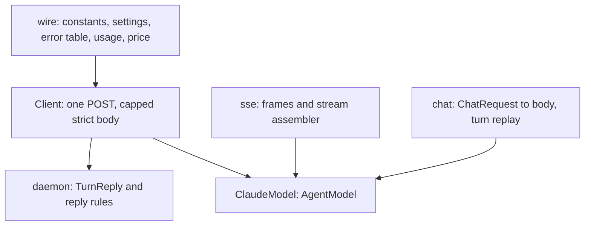

# Design — Issue #2605: one Anthropic `AgentModel`

The agent crate ships the `AgentModel` trait and no provider. Two examples
each hold a Claude client: `examples/autoresearch/src/claude.rs` and
`examples/claude-agent-daemon/src/claude.rs`. Two more examples,
`agent-mesh` and `recall-eval`, borrow the autoresearch copy. The copies
drift.

This change moves one Anthropic client into `autumn-harvest-agent`, behind
the `anthropic` feature. Every example uses it and deletes its copy. The
crate without the feature gains no dependency.

**No migration. No new `WorkflowEvent` variant. No change to history.**

---

## 0. Planning record

### 0.1 Facts

| Fact | Source |
|---|---|
| The two copies send two API versions: `2026-10-21` and `2023-06-01`. | Both `claude.rs` files. |
| The two copies have two default models: `claude-opus-5-5` and `claude-opus-5`. | Both `claude.rs` files. |
| autoresearch omits `thinking`. The daemon sends `{"type": "adaptive"}`. Opus 5.5 accepts both and runs adaptive. | Anthropic model notes. |
| Opus 5.5 defaults to effort `medium`. autoresearch sets `high`. The daemon sets nothing. | Anthropic model notes. |
| autoresearch retries `408`, `409`, `429` and `5xx`, as the Anthropic SDKs do. The daemon refuses `409`. | Both files. Anthropic SDK docs. |
| autoresearch decodes a body with `from_utf8_lossy`. The daemon refuses bytes that are not UTF-8, because U+FFFD can change a tool path. | Both files. |
| The autoresearch model id is `claude-opus-5-5+effort=high+fallbacks=default`. The ledger refuses `=`, so it records `unknown`. | `docs/llm-cost-ledger.md`, `LlmCall::validate`. |
| Neither copy prices a call. The ledger counts each call as unpriced. | `AgentModel::cost_usd_micros`. |
| The daemon registers no ledger body, so its calls do not reach the ledger. | `daemon.rs`. |
| A key with an interior newline fails every request as a retryable error in autoresearch. The daemon refuses it at start. | Both files. |

### 0.2 Brainstorm — where does the shared model live?

| # | Idea | Verdict |
|---|---|---|
| B1 | A sibling crate `autumn-harvest-agent-anthropic`. | Rejected. A new published crate needs release, licence and docs wiring. A feature gives the same isolation. |
| B2 | An `anthropic` feature of `autumn-harvest-agent`. `reqwest` and `rustls` are optional. | **Adopted.** No new crate. The default build gains nothing. |
| B3 | Move only `ClaudeModel`. The daemon keeps its client. | Rejected. The daemon copy is where the drift is worst. |
| B4 | Rewrite the daemon on `ClaudeModel` and `ChatMessage`. | Rejected. The daemon records raw content blocks in history. A change of format breaks the resume of recorded sessions. |
| B5 | Two layers: a raw `Client` that sends one Messages body, and `ClaudeModel` on top. The daemon uses the raw layer. | **Adopted.** One HTTP path, one error table, one body cap, one settings rule. |

### 0.3 Reverse brainstorm — how can this change do harm?

| # | How to make it harmful | Mitigation |
|---|---|---|
| R1 | Change the turn key, so a restarted autoresearch run loses its thinking blocks. | The key is the same SHA-256 of the same JSON. A test pins one key as a literal. |
| R2 | Change the daemon reply format, so a recorded session does not resume. | The daemon keeps `TurnReply` and its reply rules. `a_restart_resumes_the_session_without_repeating_model_calls` stays green. |
| R3 | Retry a billed turn. | A failure after a `2xx` carries its status. The daemon refuses a retry on it, as before. |
| R4 | Add a dependency to every user of the agent crate. | The feature is off by default. A test build without it stays green. |
| R5 | Put a model id in the ledger that the ledger refuses. | A test runs `LlmCall::validate` on every id that `ClaudeModel` reports. |
| R6 | Price a call wrong, or price a model that has no known price. | Exact model names only. Unknown models are unpriced. Tests check each rate. |
| R7 | Send an empty or padded key on every turn. | `Client::new` refuses a key that is not a valid header. |
| R8 | Leak the key in a log line. | `Debug` redacts it. A test checks this. |

### 0.4 Six thinking hats

| Hat | View |
|---|---|
| White (facts) | §0.1. Two copies, four users, five drift points. |
| Red (feeling) | The daemon copy carries many hard lessons. Moving it is a risk. Keep its rules, move only the wire. |
| Black (risk) | §0.3. The worst case is a resume that fails or a turn paid twice. |
| Yellow (value) | One fix reaches every app. The ledger gets real ids and prices. A new app needs no copy. |
| Green (ideas) | A `TurnStore` trait lets each app keep raw turns where it wants. An OpenAI-compatible model can use the same shape. |
| Blue (process) | RED tests first in the new module. Then GREEN. Then move each example. Then review. |

### 0.5 Decisions on the drift

| Drift | Decision |
|---|---|
| API version | `2026-10-21`. No request sends a sampling setting. |
| Default model | `claude-opus-5-5`. A daemon session recorded on `claude-opus-5` resumes with `--model claude-opus-5`. |
| Thinking and effort | Only the default model gets `thinking: adaptive` and effort `high`. Another model gets the API defaults. |
| Fallbacks | `ClaudeModel` asks for them by default. The daemon does not ask, for the reason in its source. |
| Retry table | The SDK table: `408`, `409`, `429` and `5xx` retry. `413` is `Budget`. |
| Body decode | Strict UTF-8, with a cap and one byte past it. |

---

## 1. Design

### 1.1 Layers

### 1.2 Errors

`ApiError` has an `ErrorKind`, the HTTP status when one arrived, and a
message. `accepted()` is true for a `2xx` status. `ClaudeModel` maps it to
`AgentError`. The daemon maps an accepted failure to a terminal one.

### 1.3 Usage and cost

`usage(body)` reads the four counters. `TokenUsage::input_tokens` holds
the whole prompt, cached tokens included. `cost_usd_micros(model, usage)`
prices the exact model names in the table. A cache write uses the
five-minute rate, because the requests use the default TTL.

### 1.4 Raw turns

`TurnStore` holds the raw blocks of an assistant turn by key.
`ClaudeModel` keeps a memory copy and an optional durable store.
autoresearch keeps its directory store.

---

## 2. Acceptance criteria

| AC | Evidence |
|---|---|
| Both examples use the shared model and delete their copies. Their tests pass. | `autoresearch/src/claude.rs` is gone. The daemon module holds no endpoint, version or HTTP code. `cargo test -p autoresearch -p claude-agent-daemon`. |
| `429` and `529` are retryable. `400` is not. | `a_rate_limit_or_an_overload_retries_and_a_bad_request_does_not`. |
| Usage reaches the ledger in its form. | `every_model_id_passes_the_ledger_check`, `a_call_is_priced_from_its_four_counters`, the daemon ledger test. |
| `cargo deny` stays green. | `cargo deny check`. |

## 3. Out of scope

- An OpenAI-compatible model. It can follow on the same layers.
- A per-model price for the fast mode, the batch API or the one-hour TTL.
