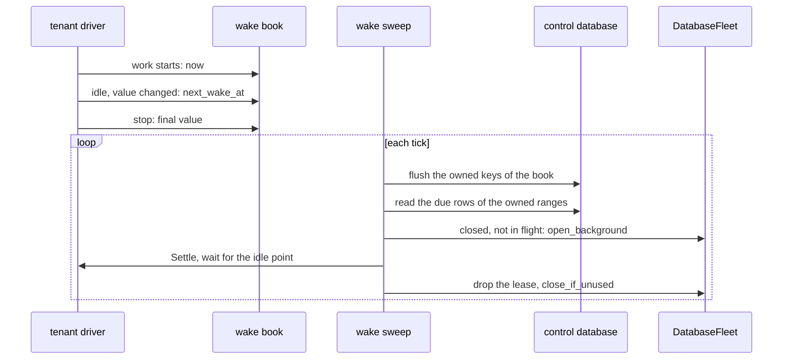

# DESIGN-2650: wake a closed tenant when its next timer or schedule is due

Issue #2650. Related: #2472 (per-tenant Harvest), #2649 (tenant Harvest
replication), autumn ADR 0019 §6 (the fleet sweeper).

## 1. Problem

`HarvestPlugin::sqlite_per_tenant()` runs a tenant driver only while the
fleet keeps the tenant open. The fleet closes an idle tenant after
`idle_close_secs`. A durable timer or a schedule slot of a closed tenant
then fires only when a request opens the tenant again. That can be hours
late, or never.

## 2. Facts

| Fact | Where |
|---|---|
| An unfired timer is a `harvest_timers` row with `fired = 0`. An external task deadline is a timer row too. | `autumn-harvest-sqlite/src/schema.rs` |
| A schedule slot is `harvest_schedules.next_run_at`, with `paused = 0`. A disabled scheduler fires no slot. | `schedule.rs`, `SqliteRuntime::poll_once_pass` |
| An activity retry waits on `harvest_tasks.run_at` of a `PENDING` task. | `queue.rs` |
| A run waits on `start_at` (workflow retry backoff) and `local_retry_at`. It times out at `deadline_at`. | `runtime.rs`, `drive_one_cycle` |
| The state index holds `cast(state as blob)`. A plain `state = 'RUNNING'` filter cannot use it. | `schema.rs` |
| `queue` and `schedule` are private. No public API returns the next deadline. | `autumn-harvest-sqlite/src/lib.rs` |
| The control database is the app's primary pool. The outbox and the fleet ownership table live there. | `sqlite/outbox.rs`, autumn `fleet_ownership` |
| `open_background` never creates a database, never restores one, and never goes past `max_open`. `close_if_unused` closes it again when no request used it. | autumn `DatabaseFleet` |
| `DatabaseFleet::owns(key)` says whether this host may serve `key`. `FleetOwnership::held` gives the ranges. | autumn `DatabaseFleet` |
| The app closes its fleet before it runs the plugin shutdown hooks. | autumn `app.rs` |
| The autumn fleet sweeper has a closed set of work kinds. It has no time-based kind. | autumn `fleet_sweeper.rs` |

## 3. Brainstorming

The chosen option is in bold.

| Question | Options |
|---|---|
| The deadline API | a reader method · **`SqliteRuntime::next_wake_at() -> SqliteResult<Option<i64>>`** (a read can fail, so no bare `Option`), and `next_wake_after(after)` |
| What counts as a deadline | timers and schedules only · **every time at which the driver has due work: timers, schedule slots, activity retry backoff, run backoff and run deadlines** |
| Where the wake row lives | the control Harvest file · a new database · **the control database, as the issue asks** |
| Who writes the row | the driver, at once · **the driver records in a memory book, and the sweep flushes it** |
| When the driver records | on each pass · **when work starts (now), at each idle point when the value changes, and at the stop** |
| How the sweep runs a tenant | `run_until_idle` in one command · **a `Settle` command that the loop answers at its next idle point** |
| How the sweep keeps the tenant open | a request open · **a background open and a lease, then `close_if_unused`** |
| How a host finds its rows | read all due rows, filter in memory · **keep `routing_slot` in the row, filter by the owned ranges in SQL, and page with a cursor** |
| The sweep interval | a new setting · **`harvest.sqlite.tick_ms`: the tick already bounds how late a due item fires** |
| Plug into the autumn sweeper | a new `PendingKind` (not public) · **a separate sweep with the same pattern** |

## 4. Reverse brainstorming

How could this change fail? Each answer gives a guard.

| How to make it fail | Guard |
|---|---|
| Report a deadline that a drive never clears, such as a timer of a run that fails on each drive. The sweep then opens the tenant on each tick. | A value due before the last idle pass started is stuck. The driver reports the earlier of the next healthy deadline and `now + 60 s`. |
| Let one stuck run hide a healthy timer of the same tenant. | `next_wake_after(pass_started)` finds the next healthy deadline. |
| Count `start_at` of a run that started long ago. | `start_at` and `local_retry_at` count only when they end after the start of the last drive. |
| Drop a backoff that ended after the last drive, when the tenant closes before the next drive. | The driver reads with `next_wake_since(last drive start)`, so the backoff stays a deadline. |
| Count a schedule while the scheduler is off, or a timer of a terminal run. | A disabled scheduler gives no slot. Each source joins a running run. |
| Wake a tenant on two hosts. A slot runs twice. | The read keeps the owned ranges. The sweep checks `owns`. The Harvest file advances a slot in its fire transaction. |
| A host that lost a range writes over the row of the new owner. | A flush drops each key that this host does not own. Each row keeps the ownership epoch of its write, and a write under an older epoch changes nothing. The check runs in the write transaction. |
| A pass moves a healthy run while another run fails, and the driver reads the pass as idle. | `poll_once_reporting` returns the progress and the error apart. The driver settles only after a pass with no progress. |
| A new owner deletes the row of a tenant that it has not restored yet. | No wake removes a row. A failed wake tries again after 60 s. Only a fleet delete removes a row. |
| Rows of other hosts, or of open tenants, fill the read. The own rows starve. | The owned-range filter, and a cursor on `(next_wake_at, tenant_key)`. |
| A broken tenant reopens on each tick. | A failed open or start defers the row by 60 s. |
| A crash during work leaves an old or empty row. | The first work after an idle point records now. A new driver records now. |
| Block a closing tenant on a control-database write while it holds the writer lock. | The driver only records in memory. The sweep writes. |
| Leave a pooled connection inside a transaction after a timeout. | The write runs as one blocking task in diesel's tracked transaction. A dropped flush puts its batch back. |
| Run the deadline read on each tick of each open tenant. | An idle point skips the read with no work and a known deadline still in the future. The read uses the state index. |
| Hold a tenant open forever on a workflow that never blocks. | The settle wait has a budget of 5 minutes. The lease then drops. |
| Wake the same tenant twice at once, or evict a tenant that a request uses. | A set of keys in flight. A background open never goes past `max_open`. |
| Lose a row on a delete, or keep an old deadline after a restore. | `on_delete` removes the row. A restore records now. |

## 5. Six thinking hats

- **White (facts).** Section 2. A tenant fleet can hold thousands of
  closed tenants. The due read uses a partial index on
  `(next_wake_at, tenant_key)`.
- **Red (feeling).** An owner who sets a 7:00 brief expects it at 7:00.
  A late brief feels broken. So the bound is one tick plus the time to
  open the tenant.
- **Black (risks).** A wake loop on a stuck tenant. A double fire on two
  hosts. A row lost in a crash before the flush: at most one tick of
  records. A tenant that has not opened since this release has no row until
  its next open.
- **Yellow (benefits).** Hosts can sleep. Timers, schedules and retries
  of closed tenants fire on time. Only the owner host does the work.
- **Green (ideas).** Reuse the tick, the background open and
  `close_if_unused`. Count retry backoff and run deadlines too: they stall
  in the same way.
- **Blue (process).** Red, then green, then refactor. The runtime API
  first, then the driver record, then the sweep. Each acceptance criterion
  has its own test. A review from four angles follows.

## 6. Design

- `autumn-harvest-sqlite/src/wake.rs` holds the deadline read. It reads
  the running runs once through the state index. It reads timers and tasks
  by run key.
- `autumn-harvest-plugin/src/sqlite/wake.rs` holds the table, the book,
  the driver record and the sweep.
- The table: `harvest_tenant_wakes (tenant_key TEXT PRIMARY KEY,
  routing_slot INTEGER, next_wake_at INTEGER, epoch INTEGER)`. `tenant_key` is
  `FleetDbKey::name`. `NULL` means no deadline.
- The control driver records nothing. It runs always.
- An app with no control database runs no sweep, and the boot logs a
  warning.

## 7. Acceptance criteria

| Criterion | Test |
|---|---|
| A closed tenant with a timer 5 s out fires the timer within one sweep of its deadline, with no request. | `a_closed_tenant_wakes_for_its_timer` |
| A schedule slot of a closed tenant runs once, not once per host. | `a_closed_tenant_runs_a_schedule_slot_once`, `a_host_wakes_only_the_tenants_it_owns` |
| `next_wake_at` covers timers, schedules, a paused schedule and no deadline. | the `next_wake_at` tests in `autumn-harvest-sqlite` |

The fleet also refuses an open of an unowned key. So the two-host test
proves the outcome, not the sweep's own ownership check. The owned-range
read has its own unit test.
