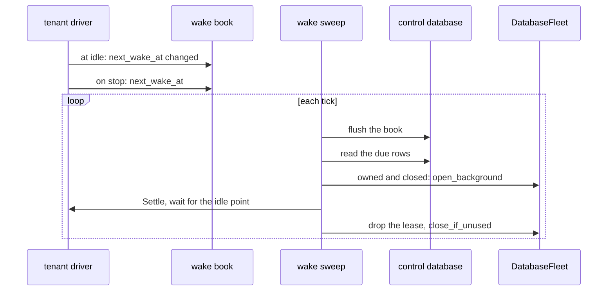

# DESIGN-2650: wake a closed tenant when its next timer or schedule is due

Issue #2650. Related: #2472 (per-tenant Harvest), #2649 (tenant Harvest
replication), autumn ADR 0019 §6 (the fleet sweeper).

## 1. Problem

`HarvestPlugin::sqlite_per_tenant()` runs a tenant driver only while the
fleet keeps the tenant open. The fleet closes an idle tenant after
`idle_close_secs`. A durable timer or a schedule slot of a closed tenant
then fires only when a request opens the tenant again. That can be hours
late, or never.

## 2. Facts

| Fact | Where |
|---|---|
| An unfired timer is a `harvest_timers` row with `fired = 0`. An external task deadline is a timer row too. | `autumn-harvest-sqlite/src/schema.rs` |
| A schedule slot is `harvest_schedules.next_run_at`, with `paused = 0`. A disabled scheduler fires no slot. | `schedule.rs`, `SqliteRuntime::poll_once_pass` |
| An activity retry waits on `harvest_tasks.run_at` of a `PENDING` task. | `queue.rs` |
| A run waits on `start_at` (workflow retry backoff) and `local_retry_at`. It times out at `deadline_at`. | `runtime.rs`, `drive_one_cycle` |
| `queue` and `schedule` are private. No public API returns the next deadline. | `autumn-harvest-sqlite/src/lib.rs` |
| The control database is the app's primary pool. The outbox and the fleet ownership table live there. | `sqlite/outbox.rs`, autumn `fleet_ownership` |
| `open_background` never creates a database and never goes past `max_open`. `close_if_unused` closes it again when no request used it. | autumn `DatabaseFleet` |
| `DatabaseFleet::owns(key)` says whether this host may serve `key`. It is `true` without ownership. | autumn `DatabaseFleet` |
| The autumn fleet sweeper has a closed set of work kinds. It has no time-based kind. | autumn `fleet_sweeper.rs` |

## 3. Brainstorming

The chosen option is in bold.

| Question | Options |
|---|---|
| The deadline API | a reader method · **`SqliteRuntime::next_wake_at() -> SqliteResult<Option<i64>>`** (a read can fail, so no bare `Option`) |
| What counts as a deadline | timers and schedules only · **every time at which the driver has due work: timers, schedule slots, activity retry backoff, run backoff and run deadlines** |
| Where the wake row lives | the control Harvest file · a new database · **the control database, as the issue asks** |
| Who writes the row | the sweep, after each wake · **the tenant driver, through a book that the sweep flushes** |
| When the driver reports | on each pass · **at each idle point when the value changes, and once when the driver stops** |
| How the sweep runs a tenant | `run_until_idle` in one command · **a `Settle` command that the loop answers at its next idle point** |
| How the sweep keeps the tenant open | a request open · **a background open and a lease, then `close_if_unused`** |
| The sweep interval | a new setting · **`harvest.sqlite.tick_ms`: the tick already bounds how late a due item fires** |
| Plug into the autumn sweeper | a new `PendingKind` (not public) · **an own sweep with the same pattern** |

## 4. Reverse brainstorming

How could this change fail? Each answer gives a guard.

| How to make it fail | Guard |
|---|---|
| Report a deadline that the driver never clears, such as a timer of a run that errors on each pass. The sweep then opens the tenant on every tick. | A value that was due when the last idle pass started is stuck. The driver reports `now + 60 s` for it. |
| Count `start_at` of a run that started long ago. It stays in the past, so each sweep wakes the tenant. | `start_at` and `local_retry_at` count only while they are in the future. |
| Count a schedule while the scheduler is off. | A disabled scheduler gives no schedule slot. |
| Count a timer of a terminal run. | Each source joins a `RUNNING` run. |
| Wake a tenant on two hosts. A slot runs twice. | The sweep skips a key that this host does not own. The Harvest file advances a slot in its fire transaction, so one host fires it once. |
| A host with no file deletes the row of a tenant that another host owns. | The sweep removes a row on `NotFound` only for a key that it owns. |
| Wake a tenant that its own driver runs. Two drivers on one file. | The sweep skips a key that has a driver. The fleet start is idempotent too. |
| Hold a tenant open forever on a workflow that never blocks. | The settle wait has a budget of 5 minutes. The lease then drops and the fleet closes the tenant. |
| Wake the same tenant twice at once. | The sweep keeps a set of keys in flight. |
| Evict a tenant that a request uses. | A background open never goes past `max_open` and does not count as a use. |
| Lose a row on a delete, then wake a deleted tenant. | `on_delete` removes the row. |
| A restore brings back an earlier deadline. | `HarvestFleet::restore` sets the row to now. The next sweep opens the tenant and the open applies the restore. |
| Block the driver on a control-database write. | The driver writes to an in-memory book. The sweep flushes it. |
| Flood the control database. | The driver reports a value only when it changes. |

## 5. Six thinking hats

- **White (facts).** Section 2. A tenant fleet can hold thousands of
  closed tenants. The wake read uses a partial index on the due rows.
- **Red (feeling).** An owner who sets a 7:00 brief expects it at 7:00.
  A late brief feels broken, so the bound must be one tick.
- **Black (risks).** A wake loop on a stuck tenant. A double fire on two
  hosts. A lost row after a crash between the report and the flush. The
  last one costs at most one tick of reports. The next open of the tenant
  writes its row again. A tenant that never closes after this upgrade has
  no row until its first close.
- **Yellow (benefits).** Hosts can sleep. Timers, schedules and retries
  of closed tenants fire on time. Only the owner host does the work.
- **Green (ideas).** Reuse the tick, the background open and
  `close_if_unused`. Count retry backoff and run deadlines too: they stall
  in the same way.
- **Blue (process).** Red, then green, then refactor. The runtime API
  first, then the driver report, then the sweep. Each acceptance criterion
  has its own test.

## 6. Design

- `autumn-harvest-sqlite/src/wake.rs` holds the deadline read. A partial
  index on unfired timers and one on pending tasks keep it cheap.
- `autumn-harvest-plugin/src/sqlite/wake.rs` holds the table, the book and
  the sweep.
- The table: `harvest_tenant_wakes (tenant_key TEXT PRIMARY KEY,
  next_wake_at INTEGER)`. `tenant_key` is `FleetDbKey::name`. `NULL` means
  no deadline.
- The control driver reports nothing. It runs always.
- An app with no control database runs no sweep, and the boot logs a
  warning.

## 7. Acceptance criteria

| Criterion | Test |
|---|---|
| A closed tenant with a timer 5 s out fires the timer within one sweep of its deadline, with no request. | `a_closed_tenant_wakes_for_its_timer` |
| A schedule slot of a closed tenant runs once, not once per host. | `a_closed_tenant_runs_a_schedule_slot_once`, `a_host_wakes_only_the_tenants_it_owns` |
| `next_wake_at` covers timers, schedules, a paused schedule and no deadline. | the `wake` tests in `autumn-harvest-sqlite` |
