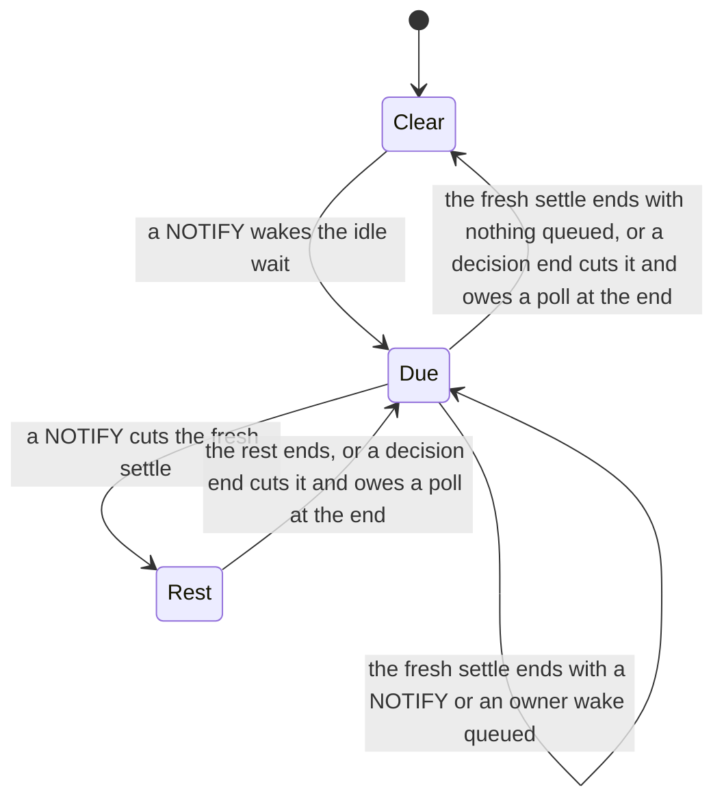

# Design — a NOTIFY cuts the settle once

`Worker::settle` sleeps 50 to 75 ms after an empty poll that a NOTIFY caused.
Before this change, only a workflow task of the same worker that ends
(`decision_done`) cut it short. A NOTIFY that arrived in the sleep stayed
queued until the next wait. So a start, a signal or an activity completion
that landed in a settle waited for the rest of it. One trace showed 64 ms
from the wake of a new task to its claim.

This change lets a NOTIFY cut a settle, once. **No migration. No new
`WorkflowEvent` variant. No claim statement changes.**

---

## 0. Planning record

### 0.1 Facts

| Fact | Effect on this design |
|---|---|
| The settle exists for a row that a host clock stamped ahead of the database `NOW()`. | A cut must keep a poll at the original end of the settle. |
| Each NOTIFY on a queue wakes every worker that listens on it. One worker claims. The others poll empty. | A settle that each NOTIFY cuts lets each worker poll once per NOTIFY. The cuts need a bound. |
| `decision_done` already cuts a settle and owes one poll at its end (`owed_poll`). | A NOTIFY cut can use the same owed end. |
| Only the leader claim loop settles. Follower loops never sleep a settle. | The change stays in the leader's idle wait. |
| The single-pool leader holds one `QueueListener`. The multi-shard leader holds one per shard. An owner wake is a NOTIFY too. | The cut must watch the same sources as the idle wait. |
| `QueueListener::wait_for_notification` reads an `mpsc` channel. | A dropped wait loses no NOTIFY, so the wait can run in a `select!`. |

### 0.2 Brainstorm — how can a NOTIFY reach the leader sooner?

| # | Idea | Verdict |
|---|---|---|
| B1 | A NOTIFY cuts the settle. The rest of the settle stays owed, and no NOTIFY cuts the rest. | **Adopted.** One cut per settle. The clock-skew margin stays. |
| B2 | Every NOTIFY cuts the settle. | Rejected. A fleet then polls once per NOTIFY. |
| B3 | Remove the settle. | Rejected. A row stamped ahead of the database clock waits a whole poll interval. |
| B4 | A shorter settle (for example 10 to 20 ms). | Rejected. It weakens the clock-skew margin and still delays each NOTIFY. |
| B5 | A cut only for the NOTIFY of a task that this worker can claim. | Rejected. The payload names a queue, not a claimant. Every worker on the queue matches. |
| B6 | A cut token bucket per worker (for example 20 cuts/s). | Deferred. A per-settle bound is simpler and gives a fixed ratio. |
| B7 | A follower claim loop polls on a NOTIFY in the settle. | Rejected. It adds a second claim at the same time, with the same fleet cost. |
| B8 | A settle that sleeps to its end takes the NOTIFYs queued then, and owes a fresh settle for them. | **Adopted** with B1. The poll at the end covers each such NOTIFY. Before, the next idle wait polled again at once. |

### 0.3 Reverse brainstorm — how can this change do harm?

| # | How to make it harmful | Mitigation |
|---|---|---|
| R1 | Each NOTIFY cuts, so a fleet polls once per NOTIFY. | A cut moves the state to `Rest(end)`. No NOTIFY cuts a rest, and no wake drops it. A Verus proof shows that the cuts never exceed the fresh settles, and that each cut owes its rest. |
| R2 | A cut drops the clock-skew poll. | The rest sleeps to the original end, then the leader polls. The rest then owes a fresh settle, so the NOTIFY that cut also gets a full margin. Unit tests check both ends. |
| R3 | A closed listener channel returns at once, so the cut spins. | In the single-pool path, a wait with no NOTIFY never ends the cut. It stays pending. In the multi-shard path, a round removes a closed listener. |
| R4 | The cut swallows a NOTIFY, and its row waits a poll interval. | A cut always leads to a poll at once. |
| R5 | A claim after the cut leaves the rest owed for a long time. | A rest whose end has passed polls at once and clears. |
| R6 | A broken shard listener breaks the settle. | The cut removes it the same way as the idle wait, with the same warning. |
| R7 | More empty polls lower the fleet capacity. | B8 removes the poll that a queued NOTIFY caused after a settle. The capacity cells run before and after with 4 worker processes. The empty polls per second are reported. |

### 0.4 Six thinking hats

- **White (facts).** The trace shows 64 ms from the wake to the claim. The
  signal round-trip p99 is 80 to 85 ms. The settle lasts 50 to 75 ms.
- **Red (feeling).** The settle is a tested guard. A change to it feels
  risky. The bound and the owed end must stay easy to see.
- **Black (risks).** More empty polls in a fleet. A lost clock-skew poll.
  A spin on a closed channel. See R1 to R7.
- **Yellow (value).** A NOTIFY in a settle waits about 1 ms, not up to
  75 ms. The signal and dispatch tails fall.
- **Green (options).** B1 to B7. A token bucket stays open if the
  measurement shows too many empty polls.
- **Blue (process).** Write the Verus spec first. Then the failing unit
  tests, then the code, then the measurement before and after.

## 1. Design

The leader keeps a `SettleState`, which replaces the `settle_pending` flag.

| State | Meaning | Next settle |
|---|---|---|
| `Clear` | Nothing is owed. | none |
| `Due` | A NOTIFY woke the leader, and the poll was empty. Or a settle slept to its end with a NOTIFY or an owner wake queued. | A fresh settle. A NOTIFY, an owner wake or a local decision end cuts it. |
| `Rest(end)` | A NOTIFY cut the settle that ends at `end`. | Sleep to `end`. Only a local decision end cuts it. |

The pure kernel is `notify::SettleState`. `Worker::settle_if_pending` takes
the state and leaves `Clear`. `notify::take_settle` gives the plan.
`notify::after_notify_cut` gives the state after a NOTIFY cuts a plan.
`notify::after_settle` gives the state after a settle ends. A rest always
owes a fresh settle. The NOTIFY that cut the settle can name a row that a
host clock stamped early, and the fresh settle gives that row its margin.
`formal/verus/src/notify_settle.rs` proves the kernel. Its model folds the
leader events over any sequence. It proves that the cuts never exceed the
fresh settles, and that each cut owes its rest. The poll count below follows
from the loop, not from the proof.

### 1.1 The bound

Take a fleet under a dense NOTIFY stream. Before this change, each worker
polled twice per settle: the poll at the end, then at once a poll for a
NOTIFY that came in the settle. B1 alone adds one poll at the cut, so three.
B8 removes the poll after the end: a NOTIFY queued at the end owes a fresh
settle, and a NOTIFY cuts that settle at once. So each worker polls twice
per settle again: at the cut and at the end. The proof allows one cut per
fresh settle. The poll count follows from the loop. So a dense stream
adds no empty poll.

Take one NOTIFY that lands in a settle. Before, the leader polled at the
end, polled again at once for the queued NOTIFY, then settled and polled at
the end of that settle. Now it polls at the cut and at the end, then
settles and polls at the end of that settle. The count is the same. The
poll for the NOTIFY moves from after the settle to the cut, and that move
is the latency win.

## 2. Acceptance criteria

| # | Criterion | Evidence |
|---|---|---|
| AC1 | The `signal_roundtrip` p99 and the `dispatch_latency` p99 are measured before and after, at 1 shard. | `docs/performance-notify-cuts-settle.md` |
| AC2 | The `capacity_noop` and `capacity_canonical` cells, with 4 worker processes, show no lower sustainable rate. | `docs/performance-notify-cuts-settle.md` |
| AC3 | Empty polls per second in the capacity cell are reported before and after. | `docs/performance-notify-cuts-settle.md` |
| AC4 | A NOTIFY cuts a settle once, and the rest keeps the original end. | Unit tests in `worker.rs` and the Verus proof. |
