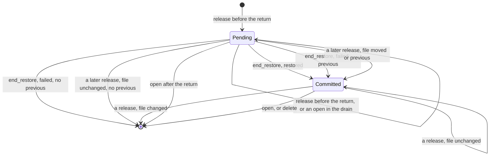

# DESIGN-2660: a direct fleet restore supersedes a pending Harvest target

Issue #2660. Follows #2649 (PR #2659).

## 1. Problem

`HarvestFleet::restore(key, Some(t1))` keeps the target `t1` in
`<tenant>.harvest.db.restore-target`. The next open restores the Harvest
file to `t1`.

A direct `DatabaseFleet::restore(key, None)` before that open restores the
database to its latest state. The target stays. The next open then takes
the Harvest file to `t1`, and the two files disagree.

The `release` hook cannot fix this alone. It runs before the restore, so
it cannot know if the restore succeeds. If it drops the target and the
restore fails, the database stays at `t1` and the Harvest file goes to its
latest state.

## 2. Facts

- `DatabaseFleet::restore` and `delete` call `release` once each, after
  the drain and before they touch the file. An open with a stale epoch
  also calls `release`, then replaces the file.
- The drain of a restore waits for an open that is still running. So the
  release of a stale-epoch open can come after the request of a restore
  and before its drain.
- A restore builds a staging file while the old file exists, then
  replaces the old file. So the new file never has the identity of the
  file that it replaces.
- A Unix inode number can come back after its file is gone.
- A fleet open waits for the drain. A Harvest open of a tenant that the
  drain closed does not wait, so `prepare` can run between `release` and
  the publish.
- `HarvestFleet::restore` calls `end_restore` after the drain ends. An
  open, a direct restore or a delete can run before it.
- A caller can drop the `HarvestFleet::restore` future. The fleet restore
  runs on in its own task.
- On Windows the identity is the creation time. A rename can keep it.

## 3. Brainstorming

The chosen option is in bold.

| Question | Options |
|---|---|
| How a target knows its database | a flag from `release` · a counter in the Harvest file · **the identity of the database file, in the target entry** |
| When the identity is known | at `end_restore` only (a crash loses the target) · **`release` writes the identity before the restore, and `end_restore` writes the identity after it** |
| Where an earlier target waits | in memory (a crash loses it) · **in the pending entry, as `previous`** |
| Which release belongs to the restore | the first after the request (a stale-epoch open can take it) · **each one before the fleet restore returns; the last one comes from its drain** |
| What a later `release` does | nothing · drop the target · **bind the target that applies now to the current file** |
| An open before the fleet restore returns | apply the pending target · drop it · **read the entry from before the request, and keep the pending target** |
| A dropped caller | accept it · a drop guard · **run the request, the restore and the end in one owned task** |
| A race of `end_restore` and an open | accept it · **one lock, `<file>.restore-target.lock`, around each change of the target file** |
| The decision rule | inline in `prepare` · **a pure kernel, `resolve_target`, with a Verus proof** |

## 4. Reverse brainstorming

"How could the Harvest file go to the wrong point in time?" Each answer
gives a rule.

| Failure | Rule |
|---|---|
| A direct restore leaves an old target live | A committed entry applies only while its database file is current. |
| A failed direct restore drops the target | The entry stays. The database file did not change, so it still applies. |
| A crash between `release` and `end_restore` loses the target | The pending entry is on disk. The open compares `from` with the current file. |
| A failed `HarvestFleet::restore` drops the earlier target | The pending entry holds it as `previous`. It applies while the file is `from`. |
| `end_restore` writes a target back after an open used it | `end_restore` writes only while the file still holds its own pending entry, under the target lock. |
| A direct restore between the drain end and `end_restore` | Its `release` binds the pending entry to the current file first. `end_restore` then finds another entry and does nothing. |
| An inode number comes back and revives an old entry | Each `release` binds the entry to the current file, or drops it. So an entry names the current file or the file just before it. A restore never gives the current number again. |
| A re-created tenant takes the target of the old one | `on_delete` removes the target file. |
| The open restores a Harvest file that already follows the database | A superseded entry forces a restore only when the Harvest file has no database record. |
| A stale-epoch open releases between the request and the drain | Each release before the return writes the target again, from the entry before the request. The release of the drain comes last. |
| An open during the drain removes the pending target | The open reads the entry from before the request. It keeps the pending target and drops the earlier one, which it used. |
| An open after the publish and before the return serves the wrong point in time | When the pending target of an unreturned restore moved, the open refuses. A retry after the return applies the target. The refusal also frees the drain from a stale-epoch open. |
| A dropped caller skips `end_restore`, or gives its request to the next restore | The request, the fleet restore and the end run in one owned task, under the restore turn. |
| A release cannot write the target | The request records the release. `end_restore` then writes the committed target. |
| A crash leaves an unreadable target, and each open refuses | A release replaces an unreadable entry. A write syncs the file before the rename. |
| A file in the older format wedges the open | The parser reads it as a pending entry that names no file, so it applies once, as before. |

## 5. Six thinking hats

- **White (facts).** Section 2. The bug needs two restores before one
  open. Each restore calls `release` first.
- **Red (feeling).** A silent mismatch of the two files is worse than a
  refused open. The rule must never guess.
- **Black (risks).** A direct restore that publishes after the drain of
  a `HarvestFleet::restore` and before its return. Its release counts as
  the `HarvestFleet` one. Run one restore of a tenant at a time. On Windows
  a restore can keep the identity, so a direct restore can still keep a
  target. A release takes a file lock from a task, so it blocks in place.
- **Yellow (benefits).** The rule reads only the file and the current
  identity. A restart, an open race and a failed restore all take the
  same path.
- **Green (ideas).** The kernel is pure, so Verus proves it with a model
  of every step. The model lets an identity come back.
- **Blue (process).** Spec and proof, then RED tests, then GREEN, then
  REFACTOR with both lights on.

## 6. Decision

The target file holds one entry:

```text
committed <of> <target>               a finished restore of the file <of>
pending <from> <target> <previous>    a restore that started on <from>
```

`<of>` and `<from>` are database identities, or `-` for no file.
`<target>` is `latest` or an RFC 3339 time. `<previous>` is a target or
`-`.



`resolve_target` gives the target that applies to the current file:

| Entry | Current file | Result |
|---|---|---|
| none | any | nothing |
| committed | `of` | apply its target |
| committed | another file | superseded |
| pending | another file than `from` | apply its target |
| pending | `from` | apply `previous`, or nothing |

1. `HarvestFleet::restore` runs its request, the fleet restore and the
   end in one owned task, under the restore turn.
2. `release` takes the target lock. Before the fleet restore returns, it
   writes the pending entry again, from the entry before the request.
   After that, it binds the entry to the current file.
3. `end_restore` takes the lock. While the file holds its pending entry,
   it writes a committed entry, or puts `previous` back.
4. `prepare` takes the lock for the whole open. Before the return, it
   refuses when the pending entry moved. Otherwise, before the return, it
   reads the entry from before the request and keeps the pending entry.
   After the return, it applies the result, then removes the file.
5. `on_delete` removes the target file.

## 7. Acceptance criteria

1. A test runs `HarvestFleet::restore(Some(t1))`, then a direct
   `DatabaseFleet::restore(None)`, then an open. The Harvest file is at
   its latest state.
2. A test runs `HarvestFleet::restore(Some(t1))`, then a direct restore
   that fails, then an open. The Harvest file is at `t1`.

## 8. Test plan

| Test | Proves |
|---|---|
| `formal/verus/src/restore_target.rs` | The kernel for every input. Each step keeps the invariant, so each open that does not refuse applies the target of the last finished `HarvestFleet::restore`, and none after a successful direct restore. An identity can come back. A release before the drain does no harm. An open between the publish and the return refuses. |
| `replica` unit tests | The entry format and the older format, the lock, and the rows of section 4 except the dropped caller. |
| `sqlite_plugin_fleet_replica` | AC 1 and 2 on a real app, and a dropped caller. |
