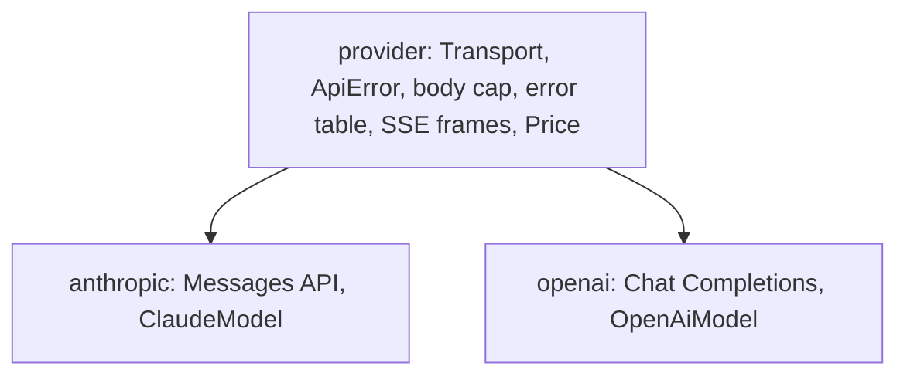

# Design — an OpenAI-compatible `AgentModel`

Issue #2605 moved one Claude model into `autumn-harvest-agent`, behind the
`anthropic` feature. That issue named the next step: an OpenAI-compatible
model on the same shape. Many providers speak the Chat Completions API:
OpenAI, OpenRouter, Ollama, vLLM, LM Studio, Groq, Together and others. One
model with a base URL reaches all of them.

This change adds the `openai` feature. It also moves the parts that do not
depend on a provider into one `provider` module, so the two models share
one HTTP path.

**No migration. No new `WorkflowEvent` variant. No change to history.**

---

## 0. Planning record

### 0.1 Facts

| Fact | Effect |
|---|---|
| Chat Completions is `POST {base}/chat/completions`. The key is `Authorization: Bearer`. | The base URL is a parameter. The key is optional, because a local server needs none. |
| OpenRouter wants `HTTP-Referer` and `X-Title` to name the app. | The client takes extra headers. |
| Tool calls come back with `arguments` as a JSON string. Some servers send an object. | Parse a string strictly. Take an object as it is. |
| A stream ends with `data: [DONE]`. `stream_options.include_usage` adds a last chunk with usage. | The assembler needs the finish reason and the end marker or the usage. |
| `prompt_tokens` includes cached tokens. `prompt_tokens_details.cached_tokens` names them. | `TokenUsage` keeps the same form as the Claude model. |
| OpenRouter can answer `200` with an `error` object. | A `2xx` body with `error` is an error of its code. |
| Prices differ for each provider and are zero for a local server. | No built-in table. The app sets a `Price`. |
| The OpenAI SDKs retry `408`, `409`, `429` and `5xx`, as the Anthropic SDKs do. | One status table for both models. |

### 0.2 Brainstorm — how do the two models share code?

| # | Idea | Verdict |
|---|---|---|
| B1 | Copy the Anthropic client into an `openai` module. | Rejected. That is the drift that issue #2605 removed. |
| B2 | A `provider` module: the transport, the error type, the body cap, the error table, the SSE frames and the price. Each model adds its wire format. | **Adopted.** |
| B3 | A generic `Provider` trait with one model type over it. | Rejected for now. Two wire formats do not justify a trait. |
| B4 | Use the `async-openai` crate. | Rejected. A large dependency, and it does not cover each compatible server. |
| B5 | Use `litellm-rs` as a library. | Rejected. It is a gateway of about 149 000 lines, at version 0.10, with 37 required dependencies. It hides the rules that the Claude client keeps: the billed-failure flag, strict UTF-8 and raw thinking replay. A LiteLLM proxy, Python or `litellm-rs`, serves the OpenAI-compatible API, so `OpenAiModel` reaches it through its base URL with no code dependency. |

### 0.3 Reverse brainstorm — how can this change do harm?

| # | How to make it harmful | Mitigation |
|---|---|---|
| R1 | Break a public path of the `anthropic` module, which the daemon uses. | Re-export each moved item from `anthropic`. Its tests and the daemon suite stay green. |
| R2 | Send the key to a redirect target, or over plain `http` by mistake. | No redirect, as in the Claude client. A key over plain `http` to a host that is not loopback is refused. |
| R3 | Run a tool with an input that the model did not send. | Strict UTF-8 on the stream. Strict JSON on each argument string. |
| R4 | Mix cache entries of two servers that use one model name. | The model id names the host and the path: `{model}@{host}{path}`. |
| R5 | Count a stream that broke off as complete, with no usage. | A stream needs a finish reason, and the end marker or the usage. |
| R6 | Price a call with a guess. | No built-in price. An unset price is unpriced. |
| R7 | Lose a tool call id, so a result cannot find its call. | A missing id becomes `call_{origin}_{index}`. The origin comes from the response, so the id is the same on each read of one response and differs across responses. |

### 0.4 Six thinking hats

| Hat | View |
|---|---|
| White | §0.1. One API shape, many servers. |
| Red | Local models are the main use for a personal agent. They must work with no key. |
| Black | §0.3. The worst case is a tool run on a value the model did not send. |
| Yellow | One base URL reaches many providers. The shared layer keeps the fixes in one place. |
| Green | A per-request `seed` from the draw id gives each draw its own sample. |
| Blue | Extract the shared layer with the Anthropic tests green. Then RED and GREEN for `openai`. Then the examples. |

---

## 1. Design

- `OpenAiModel::new(base_url, model)` takes the base URL, for example
  `openai::OPENROUTER_BASE_URL`. `api_key(key)` adds the bearer key.
  `header(name, value)` adds a header.
- `chat` sends one request. `chat_stream` streams it.
- `model_id` is `{model}@{host}{path}` unless the app sets one.
- `price(Price)` prices each call. The default is unpriced.
- With a draw, the request sends `seed` = the draw number.

## 2. Acceptance criteria

| AC | Evidence |
|---|---|
| The model talks to any Chat Completions server through a base URL, with an optional key and extra headers. | Client and model tests against a local HTTP server. |
| Tool calls, tool results, usage and stop reasons map both ways. | `openai::wire` tests. |
| A stream passes text deltas and builds the same response as a plain call. | `openai::stream` tests and a model stream test. |
| `429` and `5xx` retry. `400` does not. | Status tests through the client. |
| The model id passes the cost ledger check. A set price reaches the ledger. | Model tests with `LlmCall::validate`. |
| The Claude model keeps its behaviour and public paths. | The `anthropic` suite and the daemon suite. |
| The examples can run on an OpenAI-compatible server. | `--model openai` in autoresearch, agent-mesh and recall-eval. |
