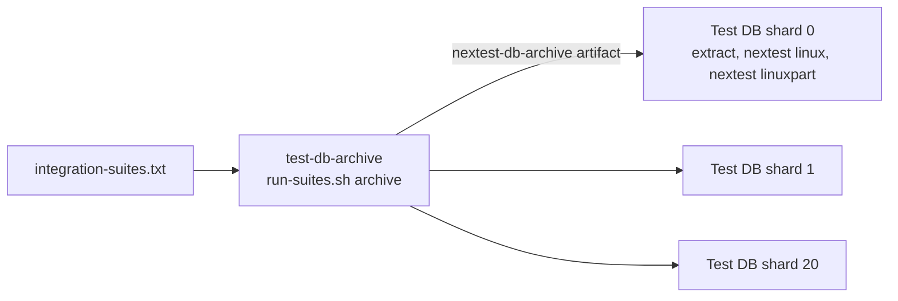

# The live-DB test archive

The `linux` and `linuxpart` rows of `.github/ci/integration-suites.txt`
need Docker Postgres. CI builds their test binaries once and runs them
on 21 shards. The tool is [cargo-nextest](https://nexte.st), at the
version that `ci.yml` pins.



## Why

Before the archive, each shard ran `cargo test` for its own rows, so each
shard compiled. Each change of feature set rebuilt `autumn_harvest`. On
shard 15 of a green trunk-dev run, the compile took 15.6 of the 22.4
minutes of the suite step. All 21 shards paid it.

## What the archive job builds

`run-suites.sh archive` makes one `cargo nextest archive` call:

- one `-p` for each crate of a `linux` or `linuxpart` row;
- one `--test` for each target of those rows;
- `--features` with the union of their feature columns, each feature
  qualified by its crate.

One call resolves features once, so the archive uses the union. Each
feature in it is additive. A suite can see a test that a row without
the feature did not compile. That test then runs too.

The archive builds without debug info. A plugin test binary is about
1.4 GB with full debug info and about 130 MB without it. A panic still
names its file and line. Set `CARGO_PROFILE_TEST_DEBUG` and
`CARGO_PROFILE_DEV_DEBUG` to override it.

## What a shard runs

1. `run-suites.sh extract` unpacks the archive into `./target`. GitHub
   checks the repository out at the same path in every job. A path that
   a test bakes in with `env!` therefore still names the file. The
   `standalone-runner` acceptance test uses `CARGO_BIN_EXE_*` and
   `CARGO_TARGET_TMPDIR` that way.
2. `run-suites.sh nextest linux` runs the `linux` rows. It builds one
   filterset from the rows and passes `--partition hash:<k>/21`.
3. `run-suites.sh nextest linuxpart` does the same with
   `HARVEST_TEST_PARTITIONED=1`.

A row with a filter selects the tests whose name contains the filter.
That is the match the positional filter of `cargo test` makes. Print the
filterset of a class with:

```sh
bash .github/ci/run-suites.sh filterset linux
```

Each test runs in its own process, one at a time. A suite that serializes
on process-global state is therefore still serial.

The hash sends the tests of one suite to many shards. So each shard sets
`PULL_EVERY_SUITE_IMAGE=1` and pre-pulls every emulator image. The row
plan of `pull-test-images.sh` cannot name the shards that need one.

## Run a shard locally

Docker must run. Build the archive, unpack it, and run one shard:

```sh
bash .github/ci/run-suites.sh archive /tmp/nextest-db.tar.zst
bash .github/ci/run-suites.sh extract /tmp/nextest-db.tar.zst
SEMAPHORE_SHARD_COUNT=21 SEMAPHORE_SHARD_INDEX=0 \
  bash .github/ci/run-suites.sh nextest linux
```

Leave out the two shard variables to run every row. `DRY_RUN=1` prints
each command.

## What stays on `cargo test`

- The coverage nightly runs `run-suites.sh run linux` under
  `cargo llvm-cov`. It shards by row ordinal at the same count.
- The `allos` rows and the `compile` mode run on all three operating
  systems in `test-nodb`.
- Doctests. nextest does not run them.

## Guards

`autumn-harvest/tests/integration/ci_nextest_archive.rs` runs the script
with `DRY_RUN=1`. It checks that the archive holds every crate, target
and feature of a live-DB row. It checks that each row gives one term of
the filterset, and that the shard index maps to the partition. It runs
on Unix only. `ci_run_coverage.rs` checks that `ci.yml` calls each mode.
